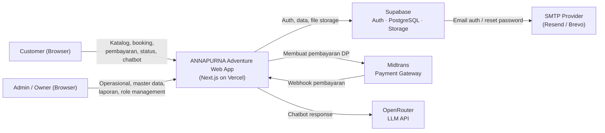
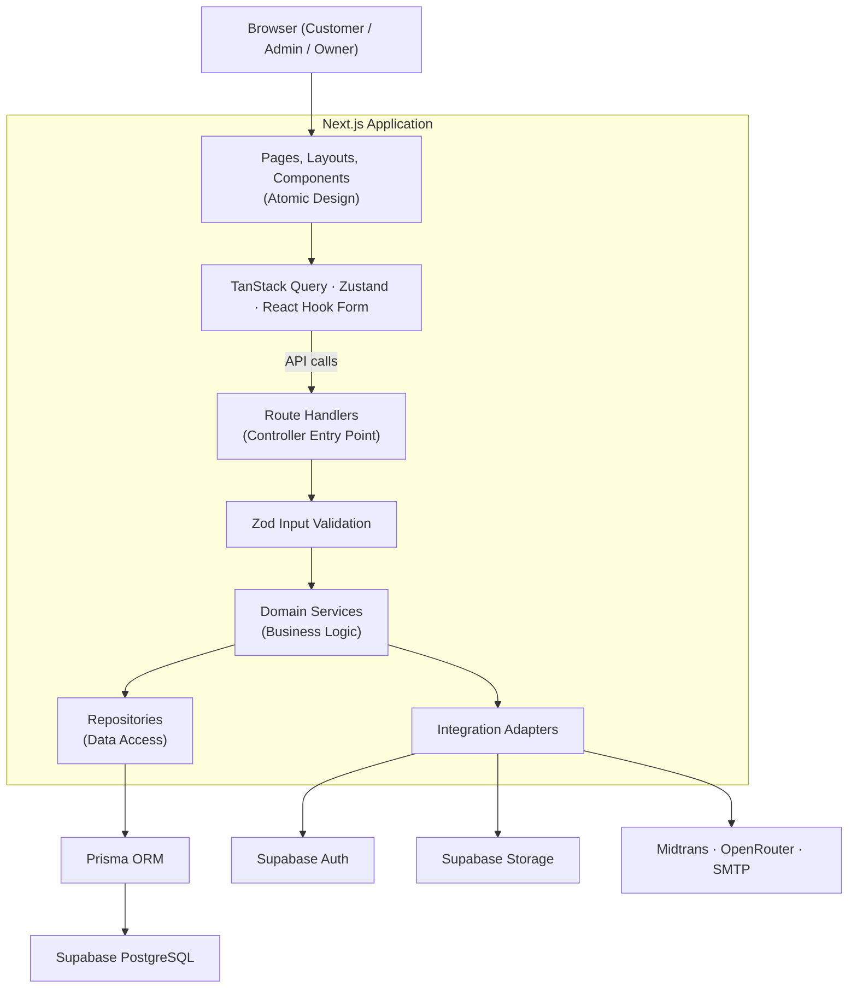
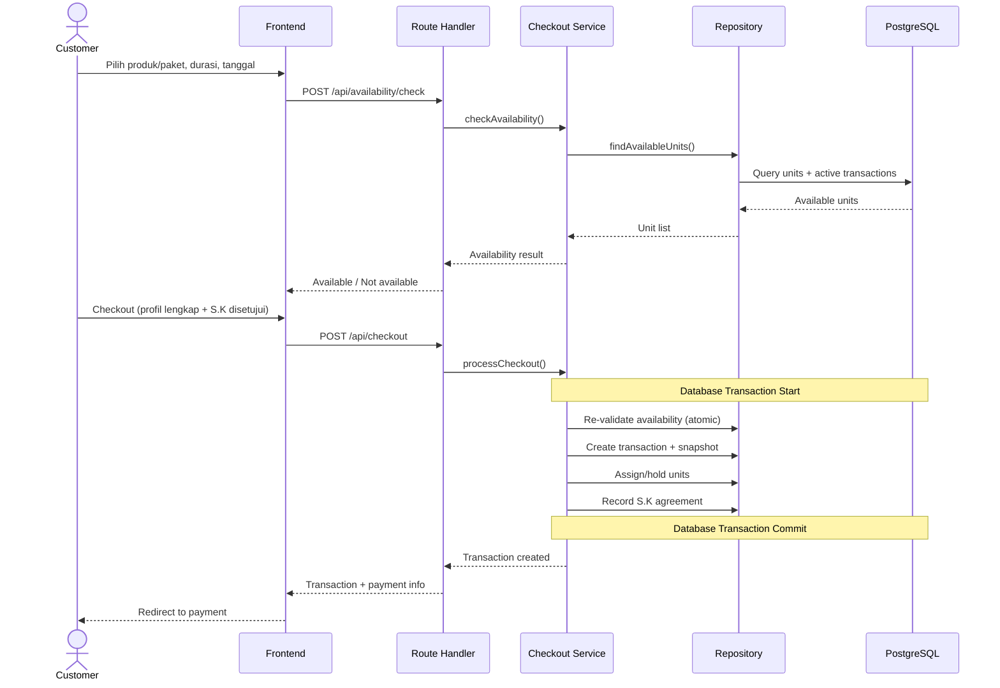
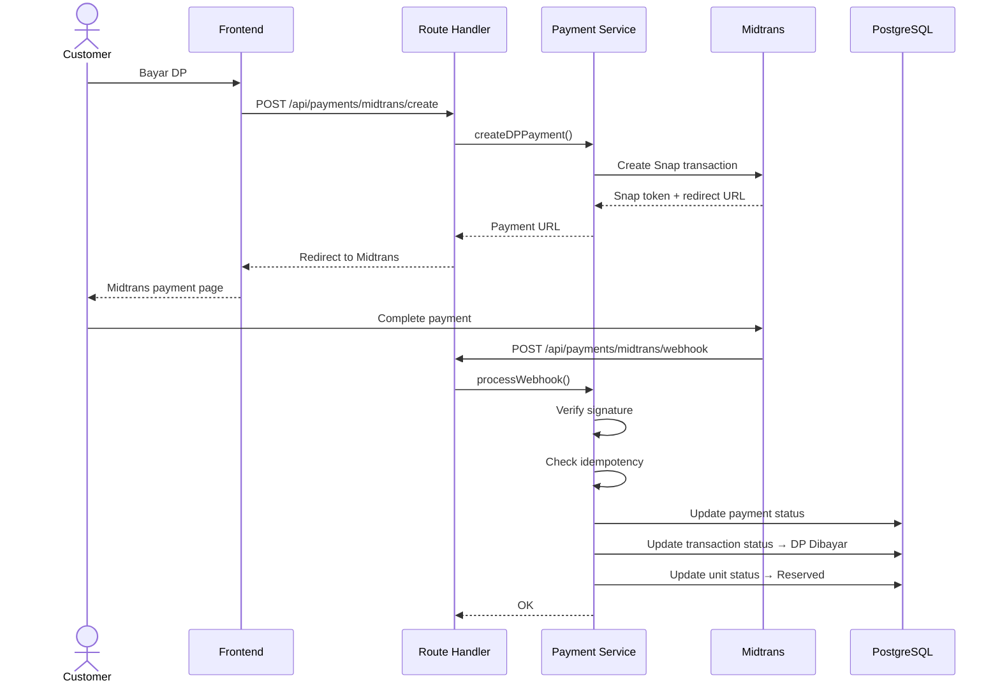
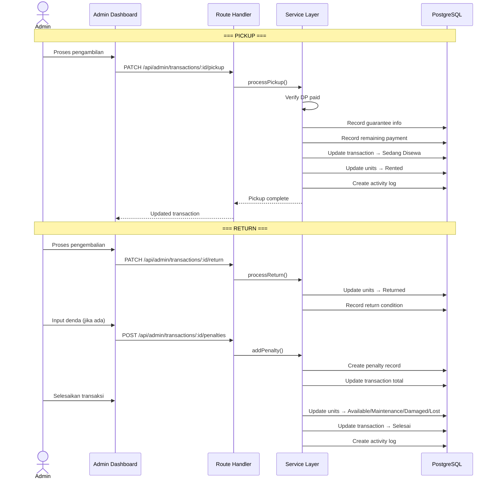
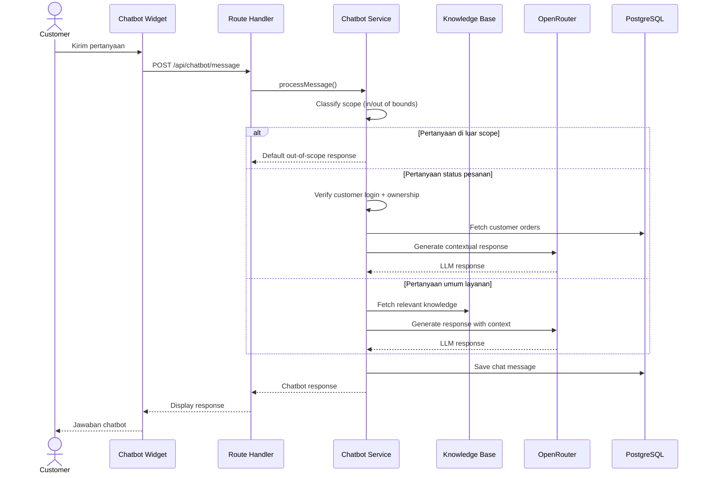
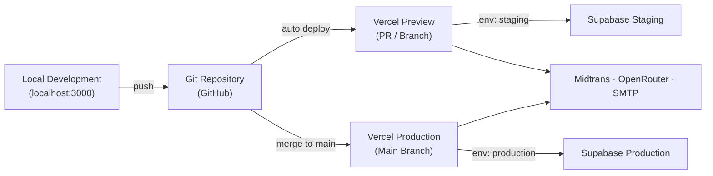

# Architecture — Sistem Informasi Penyewaan Alat Outdoor Berbasis Website
## ANNAPURNA Adventure

---

## 1. Overview

Dokumen ini menjelaskan arsitektur teknis ANNAPURNA Adventure — sistem informasi penyewaan alat outdoor berbasis website. Dokumen mencakup tech stack, justifikasi keputusan teknis, struktur folder, alur data antar layer, strategi integrasi, dan deployment.

Referensi utama:
- `prd.md` — Sumber kebenaran untuk business requirement, functional logic, dan API boundaries.
- `design.md` — Spesifikasi desain visual dan UI/UX.
- `schema.md` — Struktur database, tipe data, constraint, dan relasi.

---

## 2. System Context

Sistem terdiri dari satu aplikasi web monolitik (Next.js) yang terintegrasi dengan layanan managed eksternal.



**Aktor:**
- **Customer** — Melihat katalog, booking, bayar DP, lihat status pesanan, chatbot.
- **Admin** — Kelola produk/paket/unit, proses transaksi, pickup/return, denda, knowledge base.
- **Owner** — Laporan, export, kelola user/role, activity log.

**Layanan Eksternal:**
- **Supabase** — Identity, database, object storage.
- **Midtrans** — Payment gateway untuk DP 50%.
- **OpenRouter** — LLM untuk chatbot customer.
- **SMTP Provider** — Email transaksional (reset password, notifikasi auth).

---

## 3. Tech Stack & Justification

### 3.1 Frontend

| Teknologi | Versi Target | Justifikasi |
|---|---|---|
| **Next.js App Router** | 14+ | Full-stack framework React dengan SSR/SSG, API routes, dan deployment Vercel yang seamless. App Router dipilih karena mendukung Server Components, nested layouts, dan streaming — lebih modern dari Pages Router. |
| **TypeScript** | 5+ | Type safety mengurangi runtime error, mempermudah refactoring, dan memaksa kontrak data yang jelas antar layer. |
| **Tailwind CSS** | 3+ | Utility-first CSS yang mempercepat development, konsisten dengan design tokens, dan memiliki ekosistem besar. Menghindari CSS-in-JS overhead. |
| **shadcn/ui** | Latest | Komponen headless yang accessible, customizable, dan tidak menambah dependency berat. Berbeda dari component library tradisional karena kode di-copy ke project — full control tanpa vendor lock-in. |
| **Zustand** | 4+ | Global state manager yang ringan (~1KB), API minimal, dan tidak memerlukan boilerplate seperti Redux. Digunakan untuk client-side state seperti cart, selected product, dan checkout state. |
| **TanStack Query** | 5+ | Server-state management dengan caching, background refetch, stale-while-revalidate, dan deduplicated requests. Memisahkan server state dari UI state secara jelas. |
| **React Hook Form** | 7+ | Form state management (field values, dirty state, submit state) yang performant karena menghindari re-render seluruh form. **Tidak** digunakan untuk validasi — validasi hanya di backend. |
| **Zod** | 3+ | Schema validation yang type-safe, digunakan di backend untuk validasi input API. Shared schema memastikan kontrak data konsisten. |

### 3.2 Backend

| Teknologi | Justifikasi |
|---|---|
| **Next.js Route Handlers** | API endpoints terintegrasi dalam satu project, tidak perlu backend terpisah. Berfungsi sebagai controller entry point. |
| **Prisma ORM** | Type-safe database client, schema migration, dan introspection. Mengurangi raw SQL error dan mempermudah query complex relations. |
| **Supabase PostgreSQL** | Managed PostgreSQL dengan backup, monitoring, dan scaling otomatis. Row Level Security sebagai defense in depth. |
| **Supabase Auth** | Managed authentication dengan dukungan email/password dan OAuth (Google). Menghindari implementasi auth custom yang rawan security issue. |
| **Supabase Storage** | Object storage terintegrasi dengan auth policy. Diakses melalui abstraction layer agar bisa diganti ke provider lain (Cloudflare R2, S3, UploadThing). |

### 3.3 External Services

| Layanan | Justifikasi |
|---|---|
| **Midtrans** | Payment gateway lokal Indonesia yang mendukung berbagai metode pembayaran (VA, e-wallet, QRIS). Webhook-based notification untuk status pembayaran. |
| **OpenRouter** | Gateway ke berbagai LLM model. Fleksibel untuk ganti model tanpa mengubah kode. Lebih murah dan mudah digunakan dibanding direct API provider. |
| **Resend / Brevo** | SMTP provider untuk email transaksional. Development menggunakan default Supabase Auth email; production menggunakan custom SMTP. |

### 3.4 Supporting Libraries

| Library | Justifikasi |
|---|---|
| `date-fns` | Perhitungan tanggal modular (addDays, format), locale Indonesia, tree-shakeable. Lebih ringan dari moment.js. |
| `react-day-picker` | Date picker accessible melalui shadcn/ui Calendar. Mendukung disabled dates dan locale. |
| `embla-carousel-react` | Carousel ringan melalui shadcn/ui. Swipe mobile, keyboard accessible, SSR compatible. |
| `lucide-react` | Icon set konsisten, tree-shakeable. Digunakan melalui shadcn/ui. |
| `sonner` | Toast notification minimal dan accessible. Tidak mengambil alih fokus pengguna. |
| `motion` | Micro-interaction bermakna. Optional, hanya untuk elemen penting, dengan reduced-motion fallback. |
| `recharts` | Chart sederhana untuk dashboard. Optional, hanya jika chart benar-benar dibutuhkan. |
| `@react-pdf/renderer` | Generate laporan PDF di client-side. Required saat fitur export PDF dikerjakan. |
| `exceljs` | Generate laporan Excel. Required saat fitur export Excel dikerjakan. |

### 3.5 Teknologi yang Tidak Digunakan (MVP)

| Teknologi | Alasan Tidak Digunakan |
|---|---|
| Redux | Overkill untuk skala MVP. Zustand lebih ringan dan API lebih sederhana. |
| Redis | Tidak diperlukan karena data dinamis dan sensitif. Evaluasi jika performa jadi masalah. |
| Background Jobs/Queue | Tidak diperlukan pada MVP. Evaluasi jika expired booking atau export besar jadi bottleneck. |
| React Native / Flutter | Bukan mobile app. Website responsive sudah mencukupi kebutuhan MVP. |
| CSS-in-JS (styled-components, emotion) | Tailwind CSS lebih performant dan konsisten dengan design system. |
| REST framework terpisah (Express, Fastify) | Next.js Route Handlers sudah cukup. Satu project = lebih mudah dikelola. |

---

## 4. Folder Structure

Struktur mengikuti best practices: **Atomic Design** untuk frontend components, **Layered Architecture** untuk backend, dan **feature-based grouping** untuk halaman.

```
annapurna-rent/
├── public/                          # Static assets
│   ├── fonts/                       # Self-hosted Manrope font files
│   ├── images/                      # Static images (logo, favicons, etc)
│   └── videos/                      # Static video assets jika ada
│
├── prisma/
│   ├── schema.prisma                # Prisma schema definition
│   ├── migrations/                  # Database migration files
│   └── seed.ts                      # Database seeder
│
├── src/
│   ├── app/                         # Next.js App Router
│   │   ├── (auth)/                  # Auth route group (tanpa layout)
│   │   │   ├── login/
│   │   │   │   └── page.tsx
│   │   │   ├── register/
│   │   │   │   └── page.tsx
│   │   │   ├── forgot-password/
│   │   │   │   └── page.tsx
│   │   │   └── reset-password/
│   │   │       └── page.tsx
│   │   │
│   │   ├── (customer)/              # Customer route group
│   │   │   ├── layout.tsx           # Customer layout (navbar + footer)
│   │   │   ├── page.tsx             # Homepage
│   │   │   ├── katalog/
│   │   │   │   ├── page.tsx         # Product catalog
│   │   │   │   └── [id]/
│   │   │   │       └── page.tsx     # Product detail
│   │   │   ├── paket/
│   │   │   │   ├── page.tsx         # Package catalog
│   │   │   │   └── [id]/
│   │   │   │       └── page.tsx     # Package detail
│   │   │   ├── cart/
│   │   │   │   └── page.tsx         # Cart & checkout
│   │   │   ├── pesanan/
│   │   │   │   ├── page.tsx         # My orders list
│   │   │   │   └── [id]/
│   │   │   │       └── page.tsx     # Order detail
│   │   │   ├── profil/
│   │   │   │   └── page.tsx         # Profile completion & edit
│   │   │   └── syarat-ketentuan/
│   │   │       └── page.tsx         # Terms & conditions
│   │   │
│   │   ├── (admin)/                 # Admin/Owner route group
│   │   │   ├── layout.tsx           # Admin layout (sidebar + header)
│   │   │   └── dashboard/
│   │   │       ├── page.tsx         # Dashboard ringkasan
│   │   │       ├── kategori/
│   │   │       │   └── page.tsx
│   │   │       ├── produk/
│   │   │       │   ├── page.tsx
│   │   │       │   ├── [id]/
│   │   │       │   │   └── page.tsx
│   │   │       │   └── baru/
│   │   │       │       └── page.tsx
│   │   │       ├── variasi/
│   │   │       │   └── page.tsx
│   │   │       ├── unit/
│   │   │       │   └── page.tsx
│   │   │       ├── paket/
│   │   │       │   ├── page.tsx
│   │   │       │   ├── [id]/
│   │   │       │   │   └── page.tsx
│   │   │       │   └── baru/
│   │   │       │       └── page.tsx
│   │   │       ├── transaksi/
│   │   │       │   ├── page.tsx
│   │   │       │   └── [id]/
│   │   │       │       └── page.tsx
│   │   │       ├── laporan/
│   │   │       │   └── page.tsx
│   │   │       ├── syarat-ketentuan/
│   │   │       │   └── page.tsx
│   │   │       ├── chatbot/
│   │   │       │   └── page.tsx
│   │   │       ├── pengguna/
│   │   │       │   └── page.tsx
│   │   │       └── activity-log/
│   │   │           └── page.tsx
│   │   │
│   │   ├── api/                     # API Route Handlers
│   │   │   ├── auth/
│   │   │   │   ├── register/
│   │   │   │   │   └── route.ts
│   │   │   │   ├── login/
│   │   │   │   │   └── route.ts
│   │   │   │   ├── logout/
│   │   │   │   │   └── route.ts
│   │   │   │   ├── forgot-password/
│   │   │   │   │   └── route.ts
│   │   │   │   ├── callback/
│   │   │   │   │   └── route.ts     # OAuth callback
│   │   │   │   └── me/
│   │   │   │       └── route.ts
│   │   │   ├── profile/
│   │   │   │   └── route.ts
│   │   │   ├── products/
│   │   │   │   ├── route.ts
│   │   │   │   └── [id]/
│   │   │   │       └── route.ts
│   │   │   ├── packages/
│   │   │   │   ├── route.ts
│   │   │   │   └── [id]/
│   │   │   │       └── route.ts
│   │   │   ├── availability/
│   │   │   │   └── check/
│   │   │   │       └── route.ts
│   │   │   ├── checkout/
│   │   │   │   └── route.ts
│   │   │   ├── orders/
│   │   │   │   ├── route.ts
│   │   │   │   └── [id]/
│   │   │   │       └── route.ts
│   │   │   ├── payments/
│   │   │   │   └── midtrans/
│   │   │   │       ├── create/
│   │   │   │       │   └── route.ts
│   │   │   │       └── webhook/
│   │   │   │           └── route.ts
│   │   │   ├── terms/
│   │   │   │   └── current/
│   │   │   │       └── route.ts
│   │   │   ├── chatbot/
│   │   │   │   └── message/
│   │   │   │       └── route.ts
│   │   │   └── admin/
│   │   │       ├── products/
│   │   │       │   ├── route.ts
│   │   │       │   └── [id]/
│   │   │       │       ├── route.ts
│   │   │       │       └── media/
│   │   │       │           ├── route.ts
│   │   │       │           └── [mediaId]/
│   │   │       │               └── route.ts
│   │   │       ├── variants/
│   │   │       │   └── [id]/
│   │   │       │       └── route.ts
│   │   │       ├── units/
│   │   │       │   ├── route.ts
│   │   │       │   └── [id]/
│   │   │       │       └── status/
│   │   │       │           └── route.ts
│   │   │       ├── packages/
│   │   │       │   ├── route.ts
│   │   │       │   └── [id]/
│   │   │       │       ├── route.ts
│   │   │       │       ├── items/
│   │   │       │       │   └── route.ts
│   │   │       │       └── media/
│   │   │       │           ├── route.ts
│   │   │       │           └── [mediaId]/
│   │   │       │               └── route.ts
│   │   │       ├── transactions/
│   │   │       │   ├── route.ts
│   │   │       │   └── [id]/
│   │   │       │       ├── route.ts
│   │   │       │       ├── pickup/
│   │   │       │       │   └── route.ts
│   │   │       │       ├── return/
│   │   │       │       │   └── route.ts
│   │   │       │       ├── penalties/
│   │   │       │       │   └── route.ts
│   │   │       │       └── remaining-payment/
│   │   │       │           └── route.ts
│   │   │       ├── reports/
│   │   │       │   ├── transactions/
│   │   │       │   │   └── route.ts
│   │   │       │   └── export/
│   │   │       │       ├── pdf/
│   │   │       │       │   └── route.ts
│   │   │       │       └── excel/
│   │   │       │           └── route.ts
│   │   │       ├── terms/
│   │   │       │   ├── route.ts
│   │   │       │   └── [id]/
│   │   │       │       └── route.ts
│   │   │       ├── chatbot/
│   │   │       │   └── knowledge-base/
│   │   │       │       ├── route.ts
│   │   │       │       └── [id]/
│   │   │       │           └── route.ts
│   │   │       ├── users/
│   │   │       │   ├── route.ts
│   │   │       │   └── [id]/
│   │   │       │       └── role/
│   │   │       │           └── route.ts
│   │   │       └── activity-log/
│   │   │           └── route.ts
│   │   │
│   │   ├── layout.tsx               # Root layout
│   │   ├── loading.tsx              # Global loading
│   │   ├── not-found.tsx            # 404 page
│   │   ├── error.tsx                # Error boundary
│   │   └── globals.css              # Tailwind & global styles
│   │
│   ├── components/                  # Atomic Design components
│   │   ├── ui/                      # shadcn/ui primitives (atoms)
│   │   │   ├── button.tsx
│   │   │   ├── input.tsx
│   │   │   ├── badge.tsx
│   │   │   ├── card.tsx
│   │   │   ├── dialog.tsx
│   │   │   ├── select.tsx
│   │   │   ├── table.tsx
│   │   │   ├── calendar.tsx
│   │   │   ├── carousel.tsx
│   │   │   ├── skeleton.tsx
│   │   │   ├── toast.tsx
│   │   │   └── ...                  # Other shadcn/ui components
│   │   │
│   │   ├── atoms/                   # Custom atomic components
│   │   │   ├── status-badge.tsx
│   │   │   ├── price-display.tsx
│   │   │   ├── loading-spinner.tsx
│   │   │   └── empty-state.tsx
│   │   │
│   │   ├── molecules/               # Composed components
│   │   │   ├── product-card.tsx
│   │   │   ├── package-card.tsx
│   │   │   ├── rental-date-selector.tsx
│   │   │   ├── duration-picker.tsx
│   │   │   ├── media-gallery.tsx
│   │   │   ├── search-filter-bar.tsx
│   │   │   ├── confirmation-dialog.tsx
│   │   │   └── cart-item.tsx
│   │   │
│   │   ├── organisms/               # Complex UI sections
│   │   │   ├── product-catalog-grid.tsx
│   │   │   ├── package-catalog-grid.tsx
│   │   │   ├── cart-summary.tsx
│   │   │   ├── checkout-form.tsx
│   │   │   ├── order-detail-panel.tsx
│   │   │   ├── transaction-table.tsx
│   │   │   ├── report-summary.tsx
│   │   │   ├── chatbot-widget.tsx
│   │   │   └── activity-log-table.tsx
│   │   │
│   │   └── layouts/                 # Layout components
│   │       ├── customer-navbar.tsx
│   │       ├── customer-footer.tsx
│   │       ├── admin-sidebar.tsx
│   │       ├── admin-header.tsx
│   │       └── mobile-nav.tsx
│   │
│   ├── lib/                         # Shared utilities & configuration
│   │   ├── prisma.ts                # Prisma client singleton
│   │   ├── supabase/
│   │   │   ├── client.ts            # Browser Supabase client
│   │   │   ├── server.ts            # Server Supabase client
│   │   │   └── middleware.ts        # Auth middleware helper
│   │   ├── midtrans/
│   │   │   └── client.ts            # Midtrans client configuration
│   │   ├── openrouter/
│   │   │   └── client.ts            # OpenRouter client configuration
│   │   ├── storage/
│   │   │   ├── provider.ts          # StorageProvider interface
│   │   │   └── supabase-storage.ts  # SupabaseStorageProvider implementation
│   │   ├── utils.ts                 # General utility functions
│   │   ├── constants.ts             # Application constants
│   │   └── date-utils.ts            # Shared date calculation (rental duration, locale)
│   │
│   ├── services/                    # Business logic layer
│   │   ├── auth.service.ts
│   │   ├── profile.service.ts
│   │   ├── product.service.ts
│   │   ├── variant.service.ts
│   │   ├── unit.service.ts
│   │   ├── package.service.ts
│   │   ├── category.service.ts
│   │   ├── availability.service.ts
│   │   ├── cart.service.ts
│   │   ├── checkout.service.ts
│   │   ├── transaction.service.ts
│   │   ├── payment.service.ts
│   │   ├── pickup.service.ts
│   │   ├── return.service.ts
│   │   ├── penalty.service.ts
│   │   ├── report.service.ts
│   │   ├── terms.service.ts
│   │   ├── chatbot.service.ts
│   │   ├── user.service.ts
│   │   ├── media.service.ts
│   │   └── activity-log.service.ts
│   │
│   ├── repositories/                # Data access layer
│   │   ├── user.repository.ts
│   │   ├── profile.repository.ts
│   │   ├── product.repository.ts
│   │   ├── variant.repository.ts
│   │   ├── unit.repository.ts
│   │   ├── package.repository.ts
│   │   ├── category.repository.ts
│   │   ├── transaction.repository.ts
│   │   ├── payment.repository.ts
│   │   ├── return.repository.ts
│   │   ├── penalty.repository.ts
│   │   ├── terms.repository.ts
│   │   ├── chatbot.repository.ts
│   │   ├── media.repository.ts
│   │   └── activity-log.repository.ts
│   │
│   ├── schemas/                     # Zod validation schemas
│   │   ├── auth.schema.ts
│   │   ├── profile.schema.ts
│   │   ├── product.schema.ts
│   │   ├── variant.schema.ts
│   │   ├── unit.schema.ts
│   │   ├── package.schema.ts
│   │   ├── category.schema.ts
│   │   ├── checkout.schema.ts
│   │   ├── payment.schema.ts
│   │   ├── transaction.schema.ts
│   │   ├── penalty.schema.ts
│   │   ├── terms.schema.ts
│   │   ├── chatbot.schema.ts
│   │   ├── report.schema.ts
│   │   └── user.schema.ts
│   │
│   ├── types/                       # Shared TypeScript types
│   │   ├── api.types.ts             # ApiSuccess, ApiError contracts
│   │   ├── auth.types.ts
│   │   ├── product.types.ts
│   │   ├── transaction.types.ts
│   │   ├── payment.types.ts
│   │   ├── unit.types.ts
│   │   └── common.types.ts
│   │
│   ├── hooks/                       # Custom React hooks
│   │   ├── use-auth.ts
│   │   ├── use-cart.ts
│   │   ├── use-availability.ts
│   │   ├── use-products.ts
│   │   ├── use-packages.ts
│   │   ├── use-orders.ts
│   │   └── use-media-query.ts
│   │
│   ├── stores/                      # Zustand stores
│   │   ├── cart.store.ts
│   │   ├── checkout.store.ts
│   │   └── ui.store.ts
│   │
│   ├── middleware.ts                # Next.js middleware (auth, role check)
│   │
│   └── config/                      # App configuration
│       ├── routes.ts                # Route path constants
│       ├── nav-items.ts             # Navigation menu definitions
│       └── site.ts                  # Site metadata
│
├── .env.local                       # Local environment variables (gitignored)
├── .env.example                     # Environment variable template
├── next.config.ts                   # Next.js configuration
├── tailwind.config.ts               # Tailwind configuration
├── tsconfig.json                    # TypeScript configuration
├── postcss.config.js                # PostCSS configuration
├── components.json                  # shadcn/ui configuration
├── package.json
├── prd.md                           # Product Requirements Document
├── design.md                        # Design System
├── architecture.md                  # This document
├── schema.md                        # Database Schema
└── rules.md                         # AI Mentor Rules
```

### Prinsip Folder Structure

| Prinsip | Penjelasan |
|---|---|
| **Separation of Concerns** | Frontend (components, hooks, stores) terpisah dari backend (services, repositories, schemas) |
| **Atomic Design** | Components dibagi menjadi `ui/` (shadcn primitives), `atoms/`, `molecules/`, `organisms/`, dan `layouts/` |
| **Layered Architecture** | Backend mengikuti Controller (route handlers) → Service → Repository |
| **Feature Proximity** | Halaman dan API route dikelompokkan berdasarkan fitur, bukan tipe file |
| **Shared Contracts** | `types/` dan `schemas/` menjadi sumber kebenaran shared antara frontend dan backend |
| **Colocation** | Layout, loading, dan error component dekat dengan halaman yang menggunakannya |

---

## 5. Layer Architecture

Sistem menggunakan layered architecture sederhana untuk memastikan separation of concerns dan testability.



### Layer Responsibilities

| Layer | Tanggung Jawab | Tidak Boleh |
|---|---|---|
| **UI / Components** | Menampilkan state, menerima input, memberikan feedback (loading, error, success, empty) | Menentukan business rule, mengakses Prisma, menyimpan secret |
| **Client State** | Manage server state (TanStack Query), UI state (Zustand), form state (React Hook Form) | Menjalankan validasi Zod, business logic, atau memanggil database |
| **Route Handler / Controller** | Parse request, auth guard, validasi input (Zod), panggil service, format response | Menyimpan business logic atau query Prisma langsung |
| **Service** | Business rule, transaction boundary, authorization kontekstual, orkestrasi integrasi | Menghasilkan UI, bergantung pada detail HTTP |
| **Repository** | Query dan persistence melalui Prisma, pagination, filter, select/include | Menentukan status flow atau keputusan bisnis |
| **Integration Adapter** | Membungkus Supabase Storage/Auth, Midtrans, OpenRouter, SMTP | Mengekspos secret atau vendor detail ke UI |

### Rules

- Business logic **hanya** berada di service layer.
- Repository **tidak** menentukan business rule — hanya mengelola akses data.
- Route Handler berfungsi sebagai controller entry point, **bukan** tempat business logic.
- Frontend **tidak** menjalankan validasi — backend adalah satu-satunya sumber kebenaran untuk validitas input.
- Semua error response menggunakan kontrak `ApiSuccess<T>` / `ApiError` yang konsisten.

---

## 6. Data Flow Diagrams

### 6.1 Booking & Checkout Flow



### 6.2 Payment Flow (Midtrans)



### 6.3 Pickup & Return Flow



### 6.4 Chatbot Flow



---

## 7. Integration Architecture

### 7.1 Supabase Auth

```
Browser ──► Supabase Auth SDK (client-side)
                │
                ├── Email/Password signup/login
                ├── Google OAuth login
                ├── Forgot/Reset password
                └── Session management
                │
Route Handler ──► Supabase Auth (server-side)
                │
                ├── Verify session token
                ├── Get user identity
                └── Map to application role (dari database)
```

**Catatan penting:**
- Role disimpan di database aplikasi (`USERS.role_id`), bukan di Supabase Auth metadata.
- Role tidak boleh bergantung pada metadata yang dapat diubah customer.
- Google Login hanya untuk customer; admin/owner menggunakan email/password.

### 7.2 Supabase Storage

```
Admin UI ──► Route Handler ──► Media Service ──► StorageProvider Interface
                                                        │
                                                SupabaseStorageProvider
                                                        │
                                                Supabase Storage (Bucket)
```

**Storage Abstraction:**
```ts
interface StorageProvider {
  uploadFile(params: UploadFileParams): Promise<UploadedFile>
  deleteFile(path: string): Promise<void>
  getPublicUrl(path: string): string
}
```

Provider masa depan: `CloudflareR2Provider`, `UploadThingProvider`, `S3CompatibleProvider`.

### 7.3 Midtrans

```
Checkout ──► Payment Service ──► Midtrans SDK ──► Midtrans Server
                                                        │
                                                  Webhook callback
                                                        │
Route Handler ◄── POST /api/payments/midtrans/webhook
        │
Payment Service: verify signature → idempotency check → update payment + transaction
```

**Rules:**
- Webhook wajib diverifikasi sebelum memproses.
- Webhook wajib idempotent (duplikat tidak membuat pembayaran ganda).
- Sandbox mode untuk development; production credential terpisah.

### 7.4 OpenRouter

```
Customer chat ──► Chatbot Service ──► Scope classifier ──► OpenRouter API
                        │                                        │
                  Knowledge Base                          LLM Response
                  (dari database)                               │
                        │                               Chatbot Service
                        └──────── Context injection ────────────┘
```

**Rules:**
- Chatbot menolak pertanyaan di luar scope layanan.
- Status pesanan hanya untuk customer yang login (ownership check).
- Tidak ada training model custom — menggunakan RAG sederhana dengan knowledge base.

---

## 8. State Management Strategy

### 8.1 State Categories

| Kategori | Tool | Contoh |
|---|---|---|
| **Server State** | TanStack Query | Katalog produk, detail produk, status pesanan, laporan, daftar transaksi |
| **Global Client State** | Zustand | Cart booking, selected product, checkout state, UI preferences |
| **Local UI State** | React useState | Modal open/close, dropdown, tab active, form field focus |
| **Form State** | React Hook Form | Field values, dirty state, submit state, per-field errors dari API |

### 8.2 Rules

- **TanStack Query** untuk semua data dari server — jangan simpan response API di Zustand.
- **Zustand** hanya untuk state yang perlu persist lintas halaman (cart, checkout).
- **React Hook Form** mengelola form state, **bukan** validasi — error ditampilkan dari `fieldErrors` API response.
- **Local state** untuk UI kecil yang tidak perlu dibagikan.
- **Redux tidak digunakan** pada MVP — Zustand lebih ringan dan API lebih sederhana.

---

## 9. Caching & Runtime Strategy

### 9.1 Runtime

- Next.js Route Handlers menggunakan **Node.js runtime** untuk operasi yang membutuhkan Prisma dan integrasi server.
- Edge runtime **tidak digunakan** pada MVP karena Prisma tidak fully support edge.

### 9.2 Caching Strategy

| Endpoint | Cache | Alasan |
|---|---|---|
| Katalog produk/paket (public) | Controlled cache + revalidation | Data jarang berubah; invalidate saat admin update produk |
| Detail produk/paket (public) | Controlled cache + revalidation | Sama seperti katalog |
| S.K penyewaan (public) | Controlled cache | Jarang berubah |
| Availability check | **No cache** | Data real-time, sensitif terhadap race condition |
| Transaksi, orders | **No cache** | Data dinamis dan sensitif per user |
| Dashboard admin | **No cache** | Data dinamis, butuh data terbaru |
| Webhook Midtrans | **No cache** | Mutation, harus diproses setiap kali |
| Chatbot | **No cache** | Kontekstual per session |

---

## 10. Deployment Architecture



### Environment Separation

| Environment | Database | Auth | Storage | Midtrans | OpenRouter |
|---|---|---|---|---|---|
| **Development** | Supabase local/staging | Supabase staging | Supabase staging | Sandbox | Test key |
| **Staging/Preview** | Supabase staging | Supabase staging | Supabase staging | Sandbox | Test key |
| **Production** | Supabase production | Supabase production | Supabase production | Production | Production key |

### Environment Variable Rules

- Secret **tidak** menggunakan prefix `NEXT_PUBLIC_`.
- Production **tidak** menggunakan database atau secret development.
- OAuth redirect URL, webhook URL, SMTP, dan storage policy dikonfigurasi **per environment**.
- `.env.example` berisi template tanpa nilai sensitif.

---

## 11. Technical Decisions Log

Log keputusan teknis penting yang sudah diambil, beserta alasan dan alternatif yang dipertimbangkan.

### ADR-001: Next.js App Router vs Pages Router

**Keputusan:** Menggunakan App Router.

**Alasan:** Server Components mengurangi client bundle, nested layouts mempermudah auth layout, dan streaming meningkatkan perceived performance. App Router adalah arah masa depan Next.js.

**Trade-off:** Learning curve lebih tinggi, beberapa library belum fully support App Router.

---

### ADR-002: Monolith vs Microservice

**Keputusan:** Monolith (satu Next.js application untuk frontend dan backend).

**Alasan:** Proyek MVP dengan satu developer. Monolith mempercepat development, mengurangi complexity deployment, dan menghindari overhead komunikasi antar service.

**Trade-off:** Backend dan frontend tightly coupled, tapi untuk skala MVP ini bukan masalah.

---

### ADR-003: Zustand vs Redux

**Keputusan:** Zustand.

**Alasan:** API minimal, bundle size ~1KB, tidak butuh boilerplate (action, reducer, middleware). Untuk kebutuhan global state MVP (cart, checkout), Zustand lebih dari cukup.

**Trade-off:** Kurang powerful untuk state yang sangat complex dengan banyak middleware, tapi tidak dibutuhkan pada MVP.

---

### ADR-004: Prisma vs Raw SQL / Drizzle

**Keputusan:** Prisma.

**Alasan:** Type-safe client, migration management, schema visualization, dan ecosystem mature. Menurunkan risiko SQL injection dan query error.

**Trade-off:** Query complex tertentu mungkin kurang optimal dibanding raw SQL. Evaluasi jika performa jadi masalah.

---

### ADR-005: Backend Validation Only (No Frontend Validation)

**Keputusan:** Validasi input **hanya** di backend menggunakan Zod. Frontend tidak menjalankan validasi apapun.

**Alasan:** Satu sumber kebenaran untuk validitas data. Menghindari duplikasi rule yang bisa menyebabkan inkonsistensi. Frontend fokus pada UX feedback (loading state, error display).

**Trade-off:** User harus menunggu round-trip ke server untuk melihat error. Dimitigasi dengan immediate loading state setelah submit.

---

### ADR-006: Storage Abstraction Layer

**Keputusan:** Menggunakan interface `StorageProvider` yang dibungkus dengan adapter.

**Alasan:** Memungkinkan pergantian storage provider (Supabase → Cloudflare R2, S3, UploadThing) tanpa rewrite besar. Satu entry point untuk semua operasi storage.

**Trade-off:** Sedikit overhead abstraction, tapi manfaat flexibility jauh lebih besar.

---

### ADR-007: Supabase Auth vs Custom Auth

**Keputusan:** Supabase Auth.

**Alasan:** Managed service yang sudah handle session management, OAuth, email verification, password reset, dan security best practices. Menghindari implementasi auth custom yang rawan vulnerability.

**Trade-off:** Tergantung pada vendor Supabase. Dimitigasi karena Supabase open-source dan bisa di-self-host jika perlu.

---

### ADR-008: OpenRouter vs Direct LLM Provider

**Keputusan:** OpenRouter.

**Alasan:** Gateway ke banyak LLM model, fleksibel untuk ganti model tanpa ubah kode, pricing transparan, dan API standard OpenAI-compatible.

**Trade-off:** Satu layer tambahan antara aplikasi dan LLM provider.
