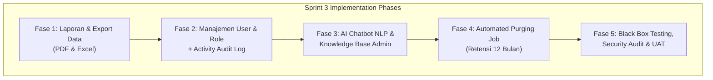

# 📋 Implementation Plan: Sprint 3 — Admin Intelligence, Reports, AI Chatbot NLP & Production Deployment

- **Proyek:** ANNAPURNA Adventure — Sistem Informasi Penyewaan Alat Outdoor Berbasis Website
- **Dokumen Referensi:**
  - [`PRD.md`](file:///d:/Kuliah/Semester%206/Penulisan%20Proposal/Project/Annapurna/PRD.md#L1718-L1740) (Sprint 3 Scope, Section 16.15–16.16, Section 17, Section 24 & 25)
  - [`admin-design-system.md`](file:///d:/Kuliah/Semester%206/Penulisan%20Proposal/Project/Annapurna/admin-design-system.md) (Standard UI/UX, Pine Green `#16624B`, tabular-nums)
  - [`Architecture.md`](file:///d:/Kuliah/Semester%206/Penulisan%20Proposal/Project/Annapurna/Architecture.md) (Security, Rate Limit, OpenRouter, Prisma Schema)
- **Status Rencana:** Siap Diimplementasikan (Phased Approach)

---

## 🎯 Tujuan & Cakupan Sprint 3

Sprint 3 merupakan sprint penutup yang melengkapi operasional bisnis ANNAPURNA Adventure dari sisi:
1. **Business Intelligence & Reporting:** Rekapitulasi transaksi, pendapatan sewa, denda, kondisi inventaris, serta ekspor PDF & Excel.
2. **Access Control & Governance:** Manajemen role pengguna (Owner-only) dan Activity Audit Log pelacak seluruh mutasi data toko.
3. **AI Customer Experience:** Virtual Assistant pelanggan berbasis LLM OpenRouter dengan Guardrails topik rental outdoor, FAQ Knowledge Base dinamis, dan fitur cek pesanan otomatis.
4. **Maintenance & Hygiene:** Automated purging cron job untuk retensi data 12 bulan (OQ-12).
5. **Quality Assurance & Production:** Final Black Box Testing, Security Audit, dan persiapan UAT deployment.

---

## 🏗️ Pembagian Fase Implementasi

---

## 📦 Detail Fase 1: Laporan Transaksi, Analitik Bisnis & Export Data (`/admin/dashboard/laporan`)

### 1.1 Service Layer (`src/lib/services/report-service.ts`)
- **Fungsi Agregasi Data:**
  - `getFinancialReport(startDate?: Date, endDate?: Date)`:
    - Menghitung Total Omzet Sewa Kotor (Gross Revenue).
    - Breakdown DP 50% yang telah settlement via Midtrans.
    - Breakdown Pelunasan Sisa Pembayaran di kasir (Cash vs QRIS Store).
    - Breakdown Penerimaan Denda (Keterlambatan, Kerusakan, Kehilangan).
  - `getInventoryHealthReport()`:
    - Statistik unit fisik berdasarkan kondisi: `Available`, `Rented`, `Maintenance`, `Damaged`, `Lost`.
    - Laporan penggunaan dan perputaran stok barang `consumable` (gas kaleng, baterai, mantol).
  - `getProductRankingReport(limit = 5)`:
    - Peringkat 5 produk rental terlaris berdasarkan frekuensi booking dan total pendapatan yang dihasilkan.
    - Peringkat 3 paket sewa outdoor terpopuler.

### 1.2 User Interface Laporan (`src/app/admin/dashboard/laporan/page.tsx`)
- **Komponen Halaman:**
  - Header dengan filter rentang waktu: Preset (*Hari Ini, 7 Hari Terakhir, 30 Hari Terakhir, Bulan Ini*) dan Kustom (*Date Range Picker*).
  - Toolbar Ekspor Data: Tombol **Export PDF** (Ikon Dokumen) dan **Export Excel** (Ikon Spreadsheet).
  - **Grid KPI Finansial:**
    - Total Omzet Masuk (DP + Pelunasan + Denda) dengan indikator perbandingan.
    - Total DP Masuk (Midtrans Settlement).
    - Total Pelunasan Toko (Cash/QRIS).
    - Total Denda Diterima (Manual penalty settlement).
  - **Tabs Tampilan Analitik:**
    1. *Tab Transaksi & Finansial:* Tabel rekap transaksi harian/bulanan dengan detail nomor invoice, penyewa, total sewa, DP, sisa, dan denda.
    2. *Tab Inventaris & Kerusakan:* Tabel unit yang sedang masuk status Maintenance/Damaged/Lost dengan catatan biaya perbaikan.
    3. *Tab Produk Terlaris:* Visual leaderboard produk & paket sewa dengan persentase kontribusi omzet.

### 1.3 Export Generator (`src/lib/services/report-export.ts`)
- **Excel (.xlsx) Generator:**
  - Menggunakan library `xlsx` (SheetJS) untuk membuat workbook dengan multiple sheets:
    - Sheet 1: `Ringkasan Finansial` (Omzet, DP, Pelunasan, Denda).
    - Sheet 2: `Daftar Transaksi` (Detail tabular seluruh transaksi dalam rentang tanggal).
    - Sheet 3: `Status Unit & Stok` (Unit rusak, hilang, servis).
- **PDF Generator:**
  - Menggunakan layout cetak resmi ANNAPURNA berstandar format A4 lanskap/portrait dengan Kop Surat Resmi, tanggal cetak, tanda tangan penanggung jawab toko, dan tabel ringkas bergaris tebal siap cetak via *native browser print engine* & download PDF instan.

---

## 🔐 Detail Fase 2: Manajemen Pengguna & Activity Audit Log

### 2.1 Manajemen Pengguna (`/admin/dashboard/pengguna`) — Owner Only
- **Otorisasi & Guarding:**
  - Layout & Server Action dilindungi validasi role `OWNER` (OQ-07). Jika staf ber-role `ADMIN` membuka URL ini, otomatis diarahkan kembali ke `/admin/dashboard` dengan notifikasi "Akses Ditolak: Khusus Pemilik Toko (Owner)".
- **Tabel Daftar Pengguna:**
  - Kolom: Nama Lengkap, Email, No. WhatsApp, Role (`CUSTOMER` / `ADMIN` / `OWNER`), Provider Auth (`email` / `google`), Status Akun (`Aktif` / `Nonaktif`), Tanggal Bergabung.
  - Fitur Pencarian & Filter Peran.
- **Aksi Kelola Pengguna:**
  - *Ubah Peran (Assign Role):* Modal konfirmasi untuk menaikkan/menurunkan peran staf (`Customer` ↔ `Admin`).
  - *Self-Demotion Lock:* Proteksi mutlak di mana akun Owner yang sedang login tidak dapat mencopot peran `OWNER` pada dirinya sendiri guna mencegah insiden *system lock-out*.
  - *Toggle Status Akun:* Mengaktifkan / menonaktifkan login user (`isActive`).

### 2.2 Activity Audit Log (`/admin/dashboard/activity-log`)
- **Audit Logger Utility (`src/lib/services/audit-log.ts`):**
  - Fungsi sentral: `logActivity(userId, action, entityName, entityId, oldValue, newValue, description)`.
  - Terintegrasi otomatis pada aksi:
    - CRUD Master Data (Produk, Variasi, Kategori, Unit).
    - Operasional Toko (Pengambilan/Pickup, Pengembalian/Return, Denda Manual).
    - Perubahan Role Pengguna & Status Akun.
- **Tampilan Audit Log:**
  - Tabel kronologis dengan timestamp format Indonesia, nama aktor (user/staf), badge aksi (`CREATE`, `UPDATE`, `DELETE`, `PICKUP`, `RETURN`, `PENALTY`, `ROLE_CHANGE`), dan entitas terkait.
  - Dialog modal *Inspect Changes* yang menampilkan perbandingan teks *Old Value* vs *New Value* secara terformat.

---

## 🤖 Detail Fase 3: AI Customer Support Chatbot (OpenRouter NLP)

### 3.1 Modul Admin Knowledge Base (`/admin/dashboard/chatbot`)
- Mengelola data tabel `ChatbotKnowledgeBase`:
  - Topik pertanyaan (misal: "SOP Pengambilan Alat", "Ketentuan Denda", "Rekomendasi Tenda Cuaca Hujan").
  - Kata kunci / Pola pertanyaan (*Regex / Keyword matching pattern*).
  - Jawaban standar dan status aktif (`isActive`).
- Pre-populated dengan FAQ lengkap operasional ANNAPURNA Adventure.

### 3.2 Backend Service AI & Integrasi OpenRouter (`src/app/api/chatbot/chat/route.ts`)
- **Model NLP:** Terhubung ke OpenRouter API dengan LLM berkecepatan tinggi dan hemat biaya (misal: `openai/gpt-4o-mini` atau model terkonfigurasi).
- **System Prompt & Guardrails (Scope Classification):**
  - Menetapkan persona: *"Anda adalah Annapurna Assistant, asisten virtual ramah dan profesional dari ANNAPURNA Adventure penyewaan alat outdoor."*
  - **Boundary Enforcer:** Wajib menolak pertanyaan umum di luar topik sewa alat camping/outdoor, gunung, dan toko Annapurna secara sopan.
  - **Knowledge Injection:** Menginjeksikan ringkasan aturan toko dan knowledge base aktif ke dalam konteks prompt.
- **Function Calling: Cek Status Pesanan:**
  - Tool `check_order_status(transaction_code, email)`:
  - Memverifikasi status booking penyewa secara aman (*ownership check*) dan merespons dengan status sewa, waktu ambil, serta sisa pembayaran kasir.
- **Proteksi Endpoint:**
  - Rate Limiter Upstash Redis: Maksimal 10 pesan / menit per IP/User.

### 3.3 Chatbot UI Widget Sisi Publik (`src/components/organisms/chat-widget.tsx`)
- Floating Action Button (FAB) berikon bot di sudut kanan bawah halaman publik.
- Jendela percakapan modern dengan header Pine Green, indikator *typing...*, auto-scroll, dan quick chips ("Cara Sewa", "Jaminan Sewa", "Cek Status Pesanan").
- Riwayat pesan disimpan ke tabel `ChatSession` & `ChatMessage` dengan flag `isOutOfScope` untuk evaluasi akurasi bot.

---

## ⏱️ Detail Fase 4: Automated Maintenance & Purging Job (OQ-12)

### 4.1 Purging Endpoint (`src/app/api/cron/purge-expired/route.ts`)
- Endpoint khusus yang dijalankan via Vercel Cron atau trigger terjadwal:
  - Memeriksa header otorisasi `Authorization: Bearer CRON_SECRET`.
  - Membersihkan `ChatMessage` dan `ChatSession` yang berumur lebih dari 12 bulan sesuai ketetapan OQ-12.
  - Membersihkan `ActivityLog` kadaluarsa (> 12 bulan).
  - Mencatat rekap jumlah baris yang berhasil di-purge ke log sistem.

---

## 🧪 Detail Fase 5: Testing, Security Audit & Deployment Preparation

### 5.1 Black Box Testing Final (Sesuai PRD Section 24)
- Verifikasi seluruh alur lintas modul:
  - Alur Autentikasi & Google Login (Customer, Admin, Owner).
  - Alur Pemesanan & DP Midtrans 50% hingga status `DP_Dibayar`.
  - Alur Pengambilan Alat (`Pickup`) kasir & verifikasi fisik KTP/SIM.
  - Alur Pengembalian Alat (`Return`) & perhitungan denda otomatis/manual.
  - Alur Ekspor Laporan PDF & Excel.
  - Pengujian Chatbot AI: Respons FAQ, Cek Status Pesanan, dan Penolakan Out-of-Scope Prompt.

### 5.2 Security Audit
- **Credential & Secret Scan:** Memastikan tidak ada token/secret API (OpenRouter, Midtrans Server Key, Supabase Service Role) terekspos di sisi browser/client bundle.
- **Row Level Security (RLS) & Role Verification:** Memastikan endpoint mutasi admin & owner tidak dapat dieksekusi oleh user publik/customer.
- **CSRF & Rate Limit Verification:** Memastikan proteksi origin CSRF dan limit Upstash Redis aktif pada endpoint auth, checkout, payment, dan chatbot.

### 5.3 UAT Scorecard & Deployment
- Deploy preview/production ke Vercel terhubung ke Supabase PostgreSQL production.
- Menyiapkan kuesioner evaluasi UAT berstandar PRD:
  - *Task Success Rate* (Target: ≥ 90%)
  - *System Error Rate* (Target: < 5%)
  - *User Satisfaction Score* (Target: ≥ 85%)

---

## 📅 Rencana Eksekusi Bertahap

| Tahapan | Lingkup Pekerjaan | Estimasi Output |
| :--- | :--- | :--- |
| **Tahap 1** | Service agregasi laporan, halaman `/admin/dashboard/laporan`, export PDF & Excel | Halaman Laporan interaktif & file download siap pakai |
| **Tahap 2** | Manajemen Pengguna `/admin/dashboard/pengguna` (Owner-only) & Activity Log | Panel kontrol user, mutasi role, dan audit log riwayat toko |
| **Tahap 3** | Knowledge Base admin `/admin/dashboard/chatbot`, API OpenRouter NLP, widget chat publik | Chatbot AI asisten rental outdoor interaktif di web publik |
| **Tahap 4** | Endpoint cron pembersihan data retensi 12 bulan (OQ-12) | Endpoint API `/api/cron/purge-expired` terproteksi |
| **Tahap 5** | Audit keamanan, Black Box Testing komprehensif, build verifikasi | Laporan pengujian, build bersih bebas error, siap live |
