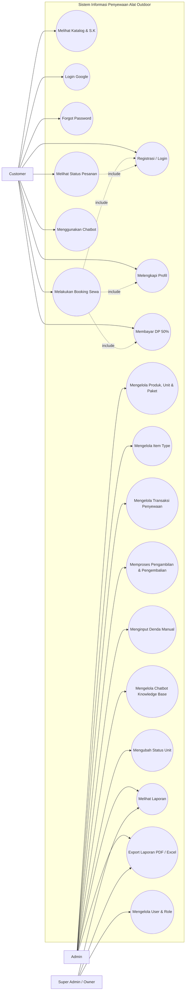
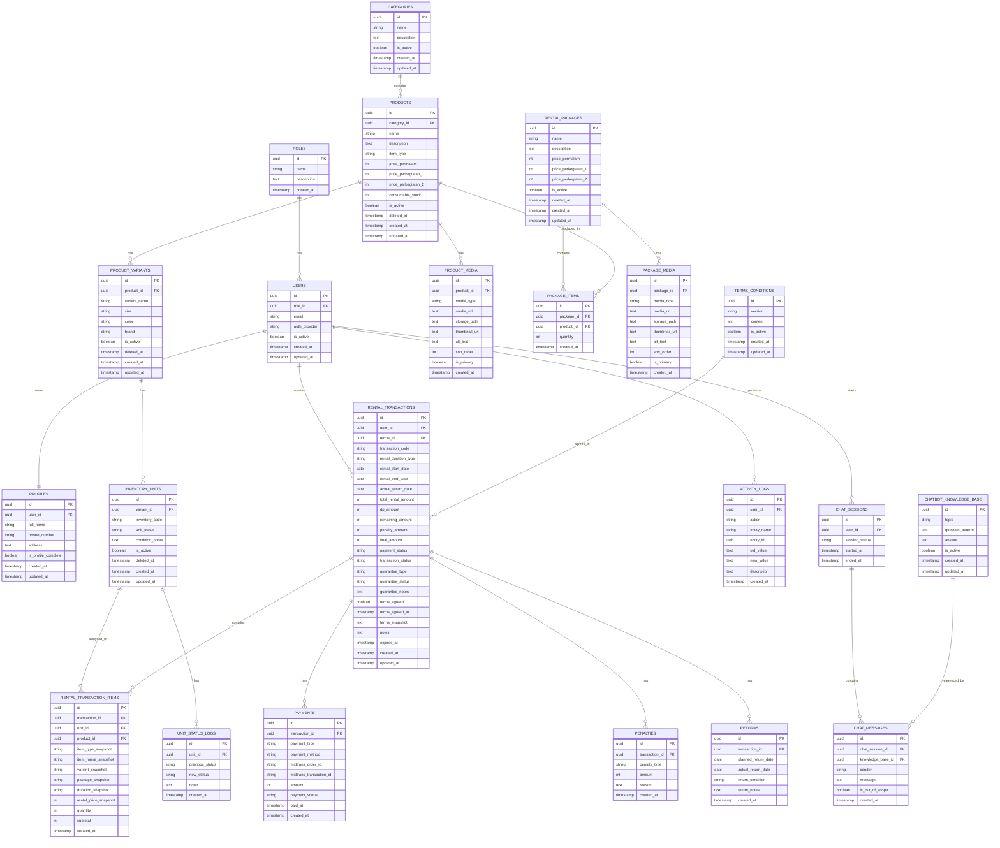
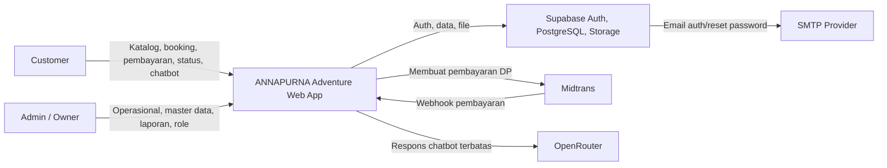
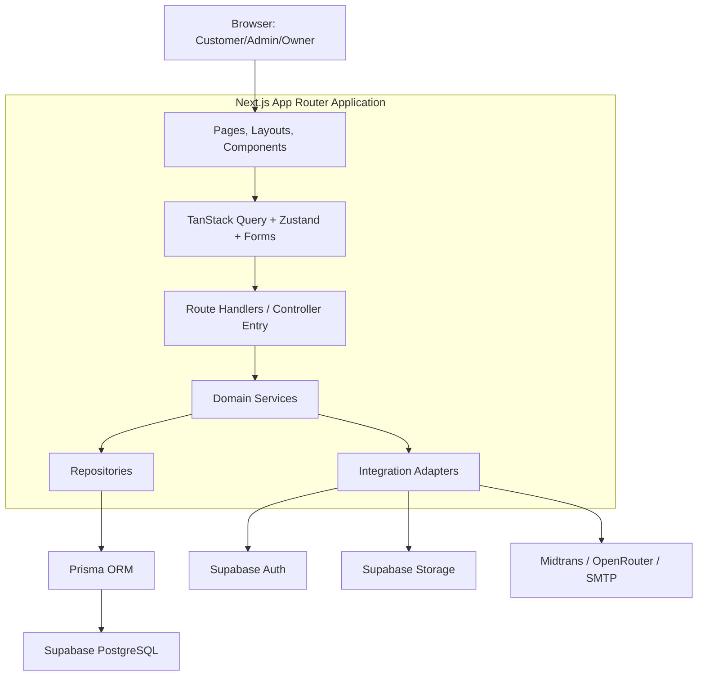
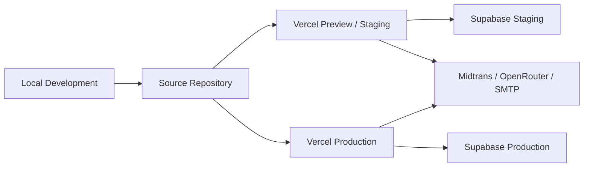

# PRD — Sistem Informasi Penyewaan Alat Outdoor Berbasis Website

## ANNAPURNA Adventure

---

## 0. Panduan Penggunaan Dokumen

Dokumen ini adalah **sumber kebenaran tunggal** untuk kebutuhan produk, UX, aturan implementasi, dan desain sistem ANNAPURNA Adventure.

Audiens utama:

- Mahasiswa/pengembang yang mengimplementasikan sistem.
- Dosen atau penguji yang menilai kelayakan produk dan rancangan sistem.
- AI mentor yang membimbing implementasi berdasarkan `rules.md`.

Urutan prioritas ketika terdapat perbedaan informasi:

1. Keputusan yang sudah ditandai sebagai **Fakta Terkonfirmasi** pada dokumen ini.
2. Functional requirements, acceptance criteria, dan business rules pada dokumen ini.
3. **Asumsi MVP** yang belum divalidasi.
4. **Pertanyaan Terbuka**, yang tidak boleh dianggap sebagai keputusan final.

Label keputusan:

| Label                   | Arti                                                            | Aturan Implementasi                                           |
| ----------------------- | --------------------------------------------------------------- | ------------------------------------------------------------- |
| **Fakta Terkonfirmasi** | Kebutuhan atau keputusan yang telah dinyatakan secara eksplisit | Boleh diimplementasikan                                       |
| **Asumsi MVP**          | Default sementara agar desain dapat dievaluasi                  | Validasi sebelum production atau jika berdampak besar         |
| **Pertanyaan Terbuka**  | Konflik atau informasi bisnis yang belum diputuskan             | Jangan mengasumsikan jawaban; minta keputusan terlebih dahulu |

Aturan perubahan:

- Jangan menambah fitur, field, status, role, atau endpoint di luar dokumen ini tanpa persetujuan.
- Jika implementasi membutuhkan perubahan kontrak API atau data model, perbarui dan review dokumen ini terlebih dahulu.
- Istilah teknis dan identifier kode menggunakan Bahasa Inggris; narasi produk menggunakan Bahasa Indonesia.
- `rules.md` mengatur cara AI membimbing pengerjaan, bukan menjadi sumber requirement produk.

---

## 1. TL;DR

Sistem ini adalah website untuk mendigitalisasi proses penyewaan alat outdoor ANNAPURNA Adventure.

Website digunakan customer untuk melihat katalog produk/paket, memilih durasi sewa, melakukan booking, membayar DP 50%, membaca S.K penyewaan, melihat status pesanan, login menggunakan email/password atau Google, reset password melalui email, dan bertanya melalui chatbot.

Admin menggunakan sistem untuk mengelola produk, variasi, unit barang, paket sewa, booking, pembayaran, pengambilan, pengembalian, denda manual, status barang rusak/maintenance, laporan, user, dan chatbot knowledge base.

Sistem hanya berfokus pada **penyewaan alat outdoor**, bukan penjualan.

---

## 2. Problem Statement

Proses penyewaan saat ini masih bergantung pada WhatsApp, media sosial, catatan manual, dan spreadsheet.

Masalah utama:

- Customer harus bertanya manual untuk mengetahui produk, harga, aturan sewa, dan ketersediaan.
- Admin harus mengecek stok dan jadwal sewa secara manual.
- Risiko bentrok jadwal penyewaan tinggi.
- Barang yang rusak atau sedang diperbaiki sulit dilacak statusnya.
- Pembayaran, pengambilan, pengembalian, dan denda belum terdokumentasi rapi.
- S.K peminjaman dan pengembalian belum tersedia secara jelas di sistem.
- Customer yang lupa password akan bergantung ke admin jika tidak ada reset password.
- Customer membutuhkan login cepat, termasuk login menggunakan Google.
- Owner sulit melihat laporan transaksi rental secara cepat.
- Admin terbebani pertanyaan berulang dari customer.

---

## 3. Goals

### 3.1 Business Goals

- Membuat proses penyewaan lebih rapi dan terdokumentasi.
- Mengurangi pengecekan stok manual.
- Mengurangi risiko overbooking.
- Mempermudah customer melakukan booking online.
- Memastikan booking valid setelah pembayaran DP 50%.
- Mempermudah customer login menggunakan email/password atau Google.
- Menyediakan fitur forgot password agar customer tidak bergantung ke admin.
- Mempermudah admin mengelola pengambilan, pengembalian, dan denda.
- Memastikan barang rusak/maintenance tidak bisa disewa.
- Menyediakan laporan transaksi rental yang dapat diexport ke PDF dan Excel.
- Mengurangi pertanyaan berulang melalui chatbot.
- Menjaga tampilan website tetap modern, professional, dan tidak terlihat generik/template.

### 3.2 User Goals

#### Customer

- Melihat katalog produk dan paket sewa.
- Melihat harga berdasarkan durasi.
- Memilih produk, variasi, atau paket.
- Login menggunakan email/password atau Google.
- Reset password melalui email jika lupa password.
- Melengkapi profil sebelum checkout.
- Melakukan booking online.
- Membayar DP 50%.
- Membaca dan menyetujui S.K penyewaan.
- Melihat status pesanan.
- Bertanya melalui chatbot.

#### Admin

- Login menggunakan email/password.
- Mengelola kategori, produk, variasi, unit barang, dan paket.
- Mengelola harga berdasarkan durasi sewa.
- Mengelola tipe item: rental unit atau consumable.
- Memproses booking masuk.
- Memantau pembayaran DP dari Midtrans.
- Mencatat jaminan identitas.
- Mencatat pelunasan sisa pembayaran.
- Memproses pengambilan dan pengembalian barang.
- Mengubah status unit barang.
- Menginput denda manual.
- Mengelola laporan transaksi.
- Mengelola chatbot knowledge base.

#### Super Admin / Owner

- Login menggunakan email/password.
- Mengelola user dan role.
- Membuat atau mengubah akun admin/owner.
- Melihat laporan transaksi rental.
- Melihat total DP, pelunasan, dan denda.
- Melihat produk/paket paling sering disewa.
- Export laporan ke PDF dan Excel.
- Melihat activity log.

---

## 4. Non-Goals

Sistem versi awal tidak mencakup:

- Penjualan produk/retail.
- Aplikasi mobile native Android/iOS.
- Pengiriman barang menggunakan ekspedisi.
- Marketplace multi-vendor.
- Perhitungan denda otomatis penuh.
- Sistem akuntansi lengkap.
- Upload foto KTP customer.
- Redis caching.
- Background jobs/queue.
- Training model AI sendiri.
- Rekomendasi alat berdasarkan cuaca/lokasi sebagai fitur utama MVP.
- Admin/owner login menggunakan Google pada MVP.
- Dashboard admin mobile yang terlalu kompleks.

---

## 5. User Roles

| Role                  | Deskripsi              | Hak Akses                                                              |
| --------------------- | ---------------------- | ---------------------------------------------------------------------- |
| Customer Unregistered | Pengunjung belum login | Melihat katalog, harga, S.K, dan menggunakan chatbot terbatas          |
| Customer Registered   | Customer sudah login   | Booking, bayar DP, lihat status pesanan, chatbot status pesanan        |
| Admin                 | Pengelola operasional  | Kelola produk, unit, paket, transaksi, pembayaran, pengembalian, denda |
| Super Admin / Owner   | Pemilik/pengawas       | Laporan, export laporan, kelola user, kelola role, activity log        |

---

## 6. Tech Stack Final

### Frontend

- Next.js App Router
- TypeScript
- Tailwind CSS
- shadcn/ui
- Zustand
- TanStack Query
- React Hook Form
- Zod

### Supporting Frontend Libraries

Library berikut digunakan secara selektif; jangan menambahkan library jika kemampuan native atau komponen yang sudah ada cukup.

| Library                | Prioritas                                   | Kegunaan                                                                                             |
| ---------------------- | ------------------------------------------- | ---------------------------------------------------------------------------------------------------- |
| `date-fns`             | Required                                    | Perhitungan tanggal maksimal pengembalian, perbandingan tanggal, dan format tanggal locale Indonesia |
| `react-day-picker`     | Required melalui shadcn/ui Calendar         | Date picker tanggal ambil yang accessible dan dapat dikustomisasi                                    |
| `embla-carousel-react` | Required melalui shadcn/ui Carousel         | Galeri beberapa foto/video produk dan paket, swipe mobile, serta kontrol previous/next               |
| `hugeicons-react`      | Required                                    | Icon set modern dan konsisten untuk kalender, navigasi, status, dan action                           |
| `sonner`               | Recommended                                 | Toast feedback untuk aksi async tanpa mengambil alih fokus pengguna                                  |
| `motion`               | Optional                                    | Micro-interaction yang bermakna; gunakan hanya pada elemen penting dan hormati reduced motion        |
| `recharts`             | Optional                                    | Visualisasi ringkas pada dashboard/laporan jika chart benar-benar dibutuhkan                         |
| `@react-pdf/renderer`  | Required saat fitur export PDF dikerjakan   | Membuat laporan PDF                                                                                  |
| `exceljs`              | Required saat fitur export Excel dikerjakan | Membuat laporan Excel                                                                                |

Catatan:

- Gunakan elemen HTML `<video controls>` untuk video katalog pada MVP; tidak perlu video-player library tambahan.
- Gunakan `next/image` untuk optimasi foto produk/paket.
- Gunakan `date-fns` dengan locale `id` dan fungsi modular seperti `addDays`/`format`; business rule tanggal tetap berada pada shared domain utility yang juga dipakai backend.
- Embla carousel wajib memiliki tombol previous/next, disabled state, keyboard support, dan indikator posisi media.
- Motion tidak digunakan sebagai dekorasi. Animasi dibatasi pada feedback, transisi state, atau orientasi navigasi, dimuat hanya pada interactive boundary, dan menggunakan reduced-motion fallback.

### Backend

- Next.js Route Handlers
- Prisma ORM
- Supabase PostgreSQL
- Supabase Auth
- Supabase Storage
- Midtrans
- OpenRouter

### Storage

- Supabase Storage untuk foto/video produk, foto/video paket, dan aset katalog.
- Foto KTP tidak disimpan pada MVP untuk mengurangi risiko keamanan data sensitif.
- Storage harus menggunakan abstraction layer agar bisa diganti ke Cloudflare R2, UploadThing, atau S3-compatible storage di masa depan.

### Payment

- Midtrans digunakan untuk pembayaran DP 50%.
- Sisa pembayaran dicatat manual oleh admin saat pengambilan barang.

### AI

- OpenRouter digunakan untuk chatbot customer.
- Chatbot fokus pada FAQ, aturan sewa, harga, produk, paket, DP, pengembalian, denda, dan status pesanan.
- Chatbot rekomendasi cuaca/lokasi tidak masuk MVP.

---

## 7. Design System

Spesifikasi desain visual (design direction, color palette, typography, UI component rules, logo usage, dan anti "AI slop" rules) dipindahkan ke dokumen terpisah **`design-system.md`** agar PRD ini tetap fokus pada business requirement dan functional logic.

Dokumen tersebut adalah bagian tidak terpisahkan dari PRD ini — perubahan pada `design-system.md` tunduk pada aturan perubahan yang sama seperti Section 0.

---

---

## 13. Engineering Implementation Rules

Project menggunakan pendekatan MVP-friendly. Implementasi harus rapi, aman, responsif, dan mudah dirawat, tetapi tidak menambahkan teknologi yang belum diperlukan dan dapat memperlambat development atau menambah biaya.

### 13.0 Aturan Wajib Lintas Sistem

- Jangan mengimplementasikan requirement di luar PRD.
- Jika requirement tidak jelas atau termasuk Pertanyaan Terbuka, minta keputusan sebelum implementasi.
- Jangan menempatkan business logic di UI component atau Route Handler.
- Gunakan shared TypeScript types dan Zod schemas untuk kontrak lintas layer.
- Semua input API wajib divalidasi dengan Zod sebelum masuk ke service.
- **Fakta Terkonfirmasi:** validasi input hanya dilakukan di backend. Frontend tidak boleh mengimplementasikan validasi apa pun (termasuk required-field check atau format check sederhana) — frontend hanya bertanggung jawab menampilkan state loading dan menerjemahkan error dari API secara jelas ke pengguna.
- Gunakan database transaction untuk booking, unit assignment, update pembayaran, dan proses pengembalian.
- Webhook Midtrans wajib diverifikasi dan diproses secara idempotent.
- Customer hanya dapat mengakses data miliknya sendiri.
- Google Login hanya tersedia untuk customer pada MVP.
- Akun admin dan owner dibuat atau dikelola manual oleh owner (lihat 14.7 dan OQ-20 untuk prosedur teknis).
- Jangan mengimplementasikan Redis self-hosted/self-managed, queue/background jobs, upload foto KTP, atau rekomendasi berbasis cuaca pada MVP.
- **Fakta Terkonfirmasi:** larangan Redis di atas berlaku untuk instance Redis yang dikelola sendiri oleh tim (misal container/VM terpisah). Layanan Redis serverless-managed (contoh: Upstash) tetap diizinkan khusus untuk rate limiting, karena secara operasional setara dengan Supabase — diakses lewat HTTP API tanpa server yang perlu dipelihara tim (lihat 30.3 dan OQ-18).
- Jangan mengubah API contract tanpa review dan persetujuan.

### 13.1 Frontend Rules

- Frontend menggunakan pendekatan component-driven.
- Struktur komponen menggunakan Atomic Design sederhana:
  - atoms
  - molecules
  - organisms
  - layouts

- Local UI state digunakan untuk modal, dropdown, tab, dan state kecil.
- Zustand digunakan untuk global state ringan seperti cart booking, selected product, selected variant, selected duration, dan checkout state.
- TanStack Query digunakan untuk server-state seperti katalog, detail produk, availability, transaksi, laporan, dan status pesanan.
- React Hook Form digunakan untuk manajemen state form (field value, dirty state, submit state), **bukan** untuk validasi.
- **Frontend tidak menjalankan validasi Zod atau validasi manual apa pun.** Backend adalah satu-satunya sumber kebenaran untuk validitas input (lihat 13.0). Frontend hanya mengirim data ke API dan menampilkan hasilnya.
- Setiap submit form wajib menampilkan state "sedang diproses" (tombol disabled, spinner/skeleton, atau progress indicator) segera setelah submit ditekan, agar interaksi tetap terasa responsif meskipun validasi backend membutuhkan waktu.
- Error validasi ditampilkan berdasarkan `fieldErrors` yang dikembalikan API (lihat kontrak `ApiError` pada Section 28), dipetakan ke field form terkait — bukan dihasilkan ulang di frontend.
- Lazy loading diterapkan hanya untuk komponen berat seperti chatbot, chart dashboard, tabel laporan besar, dan export PDF/Excel.
- Redux tidak digunakan pada MVP.
- Business rule dan perhitungan biaya tidak boleh berada di UI component.
- Semua halaman penting harus memiliki loading, empty, error, dan success state yang sesuai konteks.
- Action label harus konsisten dari tombol, dialog konfirmasi, sampai feedback hasil.

### 13.2 Backend Rules

- Backend menggunakan layered architecture sederhana:
  - Controller
  - Service
  - Repository

- Controller menerima request, validasi input, dan mengembalikan response.
- Service menjalankan business logic seperti booking, availability check, payment update, return process, dan manual penalty.
- Repository menjalankan query database.
- Semua endpoint penting wajib divalidasi menggunakan Zod.
- Query database harus efisien dan menghindari N+1 query.
- Gunakan Prisma `select`, `include`, filter, dan pagination.
- Authentication menggunakan Supabase Auth.
- Akses data dibatasi berdasarkan role dan ownership data.
- Customer hanya bisa melihat transaksi miliknya sendiri.
- Webhook Midtrans wajib diverifikasi sebelum mengubah status pembayaran.
- Webhook Midtrans harus idempotent.
- Redis tidak digunakan pada MVP.
- Background jobs/queue tidak digunakan pada MVP.
- Route Handler berfungsi sebagai controller entry point dan tidak menyimpan business logic.
- Service menjadi satu-satunya tempat orkestrasi business rule lintas repository dan integrasi eksternal.
- Repository tidak menentukan business rule; repository hanya mengelola akses data.
- Response error tidak boleh membocorkan secret, stack trace, atau data internal kepada client.
- Operasi customer wajib menerapkan ownership check meskipun akses database juga dilindungi RLS.

### 13.3 Responsive Design Rules

- Website wajib menggunakan mobile-first responsive design.
- Semua halaman customer harus optimal di mobile, tablet, dan desktop.
- Admin dashboard minimal usable di mobile dan optimal di tablet/desktop.
- Layout menggunakan Tailwind responsive utilities.
- Komponen tidak boleh memiliki fixed width yang menyebabkan horizontal scroll.
- Tabel besar di mobile harus menggunakan horizontal scroll atau card layout.
- CTA utama di mobile harus mudah dijangkau dengan tap area minimal 44px.
- Form booking dan checkout dibuat jelas, bertahap, dan mudah digunakan di mobile.
- Chatbot widget tidak boleh menutupi CTA utama.
- Gambar produk responsif dan menggunakan aspect ratio konsisten.
- Setiap halaman penting memiliki loading state, empty state, error state, dan success state.
- Responsive testing dilakukan minimal pada layar 360px, 390px, 768px, 1024px, dan 1366px.

### 13.4 Additional Engineering Rules

- Sistem menggunakan soft delete atau status aktif/nonaktif untuk produk, variasi, unit, paket, dan knowledge base.
- Sistem menyimpan audit log untuk aktivitas penting admin.
- Proses booking, assign unit, update pembayaran, dan pengembalian barang menggunakan database transaction.
- Sistem memiliki expired booking rule jika customer tidak menyelesaikan DP dalam batas waktu tertentu.
- Sistem menyimpan snapshot harga, nama produk, nama variasi, nama paket, durasi, dan S.K pada transaksi.
- Dashboard admin menggunakan pagination, search, dan filter.
- Aksi penting seperti membatalkan transaksi, mengubah status unit, menginput denda, dan menyelesaikan transaksi menggunakan confirmation dialog.
- Perubahan status transaksi dan unit harus mengikuti alur status yang valid.
- Upload file harus divalidasi berdasarkan format, ukuran, dan akses pengguna.
- Environment secret tidak boleh menggunakan prefix `NEXT_PUBLIC_`.
- Semua perubahan role, pembayaran, status transaksi, status unit, pengembalian, dan denda wajib menghasilkan activity log.

---

## 14. Authentication & Authorization

### 14.1 Authentication Features

Sistem wajib mendukung:

- Register email/password
- Login email/password
- Login with Google
- Forgot Password
- Reset Password via Email
- Logout
- Protected routes
- Role-based access
- Profile completion sebelum checkout

### 14.2 Register & Login

Requirements:

- Customer dapat registrasi menggunakan email/password.
- Customer dapat login menggunakan email/password.
- Customer dapat login menggunakan Google.
- Admin dan owner login menggunakan email/password pada MVP.
- Customer baru dari registrasi publik otomatis memiliki role `customer`.
- Admin dan owner tidak dapat dibuat dari public registration.

Acceptance Criteria:

- Customer dapat registrasi dan login.
- Customer tidak dapat mengakses dashboard admin.
- Admin dapat login ke dashboard.
- Owner dapat mengelola user dan role.

### 14.3 Google Login

Requirements:

- Customer dapat login/register menggunakan Google.
- Google Login hanya untuk customer pada MVP.
- User yang login via Google otomatis memiliki role `customer`.
- Admin dan owner tidak menggunakan Google Login pada MVP.
- Admin dan owner dibuat atau dikelola manual oleh owner.
- Customer yang login via Google tetap wajib melengkapi profil sebelum checkout.

Acceptance Criteria:

- Customer dapat login menggunakan akun Google.
- User Google baru otomatis dibuat sebagai customer.
- User Google tidak bisa menjadi admin/owner secara otomatis.
- Customer Google yang belum melengkapi profil tidak dapat checkout.
- Customer Google tetap dapat melihat katalog dan S.K.

### 14.4 Profile Completion Gate

Customer wajib melengkapi profil sebelum checkout.

Field minimum:

- Nama lengkap
- Email
- Nomor WhatsApp
- Alamat

Rules:

- Customer boleh melihat katalog tanpa profil lengkap.
- Customer boleh membaca S.K tanpa profil lengkap.
- Customer tidak boleh checkout jika profil belum lengkap.
- Sistem mengarahkan customer ke halaman lengkapi profil sebelum checkout.
- Chatbot status pesanan hanya tersedia untuk customer yang sudah login.

Acceptance Criteria:

- Checkout ditolak jika profil belum lengkap.
- Customer diarahkan ke halaman profile completion.
- Setelah profil lengkap, customer dapat melanjutkan checkout.

### 14.5 Forgot Password

Requirements:

- Customer dan admin dapat menggunakan fitur lupa password.
- Reset password dikirim melalui email.
- Implementasi menggunakan Supabase Auth reset password.
- Sistem menampilkan pesan umum agar tidak membocorkan apakah email terdaftar atau tidak.

Contoh pesan:

```text
Jika email terdaftar, instruksi reset password akan dikirim.
```

Acceptance Criteria:

- User dapat meminta reset password.
- User menerima email reset password.
- User dapat membuat password baru.
- User dapat login menggunakan password baru.
- Sistem tidak membocorkan status email terdaftar/tidak terdaftar.

### 14.6 Email & SMTP

Requirements:

- Development dapat menggunakan default email dari Supabase Auth.
- Final/demo production menggunakan custom SMTP agar email lebih reliable dan branded.
- Provider SMTP yang direkomendasikan:
  - Resend
  - Brevo

- Sistem tidak membangun SMTP sendiri.

Email reset password minimal memuat:

- Nama brand ANNAPURNA Adventure
- Instruksi reset password
- Tombol/link reset password
- Kontak admin
- Warna brand

Priority:

| Feature                | Priority    |
| ---------------------- | ----------- |
| Forgot Password        | Must Have   |
| Google Login           | Must Have   |
| Profile Completion     | Must Have   |
| Custom SMTP            | Should Have |
| Branded Email Template | Should Have |

### 14.7 Admin/Owner Auth Security

Rules:

- Admin dan owner tidak dapat dibuat dari public registration.
- Semua user baru dari registrasi publik atau Google Login default menjadi customer.
- Role admin dan owner hanya dapat dibuat/diubah oleh owner.
- Customer tidak dapat mengubah role sendiri.
- Admin dan owner login menggunakan email/password pada MVP.

**Fakta Terkonfirmasi (OQ-20) — Provisioning Akun Admin/Owner Awal:**

- Akun admin/owner awal dibuat manual melalui Supabase Auth dashboard, bukan melalui endpoint atau script publik.
- Password awal dibuat acak (bukan default/tebakan seperti "admin123") dan wajib diganti pada login pertama.
- Role (`admin`/`owner`) di-set langsung lewat SQL editor Supabase setelah user dibuat.
- Tidak ada fitur "create admin" yang diekspos ke aplikasi pada MVP; ini keputusan sadar untuk menghindari permukaan serangan tambahan, mengingat jumlah admin/owner di MVP sangat sedikit.

Acceptance Criteria:

- Customer tidak bisa mengakses dashboard admin.
- Customer tidak bisa mengubah role.
- Admin/owner hanya dapat dibuat oleh owner.
- Google Login tidak membuat admin/owner.
- Tidak ada endpoint publik atau tersembunyi yang dapat membuat akun admin/owner.

---

## 15. Storage Strategy

### 15.1 Storage Provider

Sistem menggunakan Supabase Storage pada MVP.

Digunakan untuk:

- Foto dan video produk
- Foto dan video paket
- Aset katalog/banner

Tidak digunakan untuk:

- Foto KTP
- Foto kartu identitas customer

### 15.2 Jaminan Identitas

Sistem hanya menyimpan data jaminan:

```text
guarantee_type
guarantee_status
guarantee_notes
```

### 15.3 Storage Rules

- Semua upload file wajib melalui storage abstraction layer.
- Aplikasi tidak boleh memanggil Supabase Storage langsung dari banyak tempat.
- File gambar dibatasi format:
  - JPG
  - JPEG
  - PNG
  - WEBP

- File video dibatasi format:
  - MP4
  - WEBM

- Ukuran file gambar maksimal direkomendasikan 2 MB.
- **Asumsi MVP:** ukuran file video maksimal 25 MB.
- **Asumsi MVP:** satu produk atau paket maksimal memiliki 10 media, dengan maksimal 2 video.
- Nama file harus di-randomize.
- Hanya admin yang dapat upload, menghapus, mengurutkan, dan memilih media utama produk/paket.
- Public URL dan path file disimpan di database.
- Path file harus disimpan agar media dapat dihapus/diganti jika produk atau paket diupdate.
- Setiap produk/paket wajib memiliki tepat satu media utama jika media tersedia.
- Video wajib memiliki poster/thumbnail agar galeri tidak menampilkan frame kosong.
- Penghapusan media utama wajib menetapkan media utama pengganti atau menolak aksi sampai pengganti dipilih.

### 15.4 Storage Abstraction Interface

```ts
interface StorageProvider {
  uploadFile(params: UploadFileParams): Promise<UploadedFile>;
  deleteFile(path: string): Promise<void>;
  getPublicUrl(path: string): string;
}
```

Provider awal:

```text
SupabaseStorageProvider
```

Provider masa depan:

```text
CloudflareR2Provider
UploadThingProvider
S3CompatibleProvider
```

Acceptance Criteria:

- Upload produk/paket berjalan melalui storage provider.
- Implementasi storage dapat diganti tanpa rewrite besar.
- Foto KTP tidak disimpan.
- File upload divalidasi berdasarkan format dan ukuran.
- Produk dan paket dapat menyimpan serta menampilkan lebih dari satu foto/video.
- Admin dapat mengatur urutan dan media utama.

---

## 16. Core Features

---

## 16.1 Syarat & Ketentuan Penyewaan

### Description

Sistem menyediakan halaman Syarat & Ketentuan yang dapat dibaca customer sebelum checkout. Customer wajib menyetujui S.K sebelum melakukan booking.

### S.K Peminjaman

- Customer wajib meninggalkan jaminan berupa kartu identitas asli yang masih berlaku.
- Contoh jaminan: KTP, SIM, kartu pelajar, kartu mahasiswa, dan identitas lain yang masih berlaku.
- Identitas harus mencantumkan alamat yang jelas.
- Customer wajib membayar DP (uang muka) secara online melalui Midtrans saat booking; sisa pembayaran (pelunasan) dilakukan saat pengambilan barang di toko.
- Perhitungan sewa aktif sejak barang diambil dari ANNAPURNA Adventure.
- Keterlambatan pengembalian dianggap sebagai penambahan durasi sewa.
- Barang yang sudah diambil tetap dihitung sewa meskipun tidak digunakan.
- Nominal denda keterlambatan menyesuaikan durasi keterlambatan.
- Jika terlambat 1 hari, denda dapat dihitung berdasarkan harga permalam.
- Jika keterlambatan lebih dari 1 hari dan masuk durasi perkegiatan, denda dapat mengikuti durasi sewa tersebut.
- Kerusakan atau kehilangan peralatan yang disewa menjadi tanggung jawab penuh penyewa.

Requirements:

- Halaman S.K dapat diakses tanpa login.
- Customer wajib mencentang persetujuan S.K sebelum checkout.
- Sistem menyimpan waktu persetujuan S.K pada transaksi.
- Sistem menyimpan versi S.K yang disetujui customer.
- Admin dapat memperbarui isi S.K jika aturan toko berubah.
- Chatbot dapat menjawab pertanyaan terkait S.K.

Acceptance Criteria:

- Checkout tidak dapat dilanjutkan jika customer belum menyetujui S.K.
- Detail transaksi menyimpan status persetujuan S.K.
- Detail transaksi menyimpan snapshot S.K yang disetujui.
- Customer dapat membaca ulang S.K dari halaman publik.

---

## 16.2 Rental Duration

Sistem mendukung 3 jenis durasi penyewaan sesuai aturan ANNAPURNA.

| Durasi         | Keterangan             |
| -------------- | ---------------------- |
| Permalam       | Pengembalian esok hari |
| Perkegiatan I  | Sewa 3 hari 3 malam    |
| Perkegiatan II | Sewa 5 hari 5 malam    |

**Asumsi MVP:** perhitungan tanggal maksimal pengembalian mengikuti jumlah hari kalender berikut sampai aturan jam pengambilan/pengembalian dikonfirmasi:

```text
Permalam       = tanggal_ambil + 1 hari kalender
Perkegiatan I  = tanggal_ambil + 3 hari kalender
Perkegiatan II = tanggal_ambil + 5 hari kalender
```

Requirements:

- Customer memilih salah satu durasi: Permalam, Perkegiatan I, atau Perkegiatan II.
- Sistem menampilkan harga sesuai durasi yang dipilih.
- Sistem otomatis menentukan tanggal maksimal pengembalian berdasarkan durasi.
- Tanggal maksimal pengembalian dihitung dari kombinasi tanggal ambil dan durasi terpilih.
- Tanggal maksimal pengembalian diperbarui otomatis jika tanggal ambil atau durasi berubah.
- Tanggal maksimal pengembalian bersifat read-only dan tidak dapat diubah langsung oleh customer.
- Frontend menampilkan hasil perhitungan segera untuk feedback, tetapi backend wajib menghitung ulang dan memvalidasi nilai saat availability check serta checkout.
- Tanggal ditampilkan menggunakan locale Indonesia, misalnya `Rab, 17 Jun 2026`.
- Sistem menggunakan durasi untuk availability check.

Acceptance Criteria:

- Harga berubah sesuai durasi sewa.
- Tanggal kembali otomatis sesuai durasi.
- Customer melihat `Tgl Ambil`, `Durasi`, dan `Maks. Pengembalian` dalam satu kelompok input yang jelas.
- Perubahan tanggal ambil atau durasi langsung memperbarui maksimal pengembalian tanpa input manual.
- Sistem menolak nilai tanggal pengembalian dari client yang tidak sesuai hasil perhitungan backend.
- Customer dapat melihat informasi durasi sebelum checkout.

---

## 16.3 Product Catalog

Kategori produk:

- Tenda
- Paket Camping
- Perlengkapan Tambahan
- Perlengkapan Pribadi
- Alat Masak
- Paket Barbeque

Requirements:

- Customer dapat melihat daftar produk.
- Customer dapat melihat detail produk.
- Produk memiliki nama, kategori, galeri media, deskripsi, harga permalam, harga perkegiatan I, harga perkegiatan II, dan status aktif.
- Produk dapat memiliki lebih dari satu foto dan video.
- Detail produk menampilkan media sesuai urutan yang ditentukan admin.
- Produk dapat memiliki variasi.
- Produk dapat memiliki unit barang unik.
- Produk memiliki item type: rental_unit atau consumable.
- Customer dapat filter berdasarkan kategori.
- Admin dapat CRUD produk.

Acceptance Criteria:

- Produk aktif tampil di katalog.
- Produk tidak aktif tidak tampil di katalog customer.
- Produk tanpa unit tersedia tidak dapat dipesan.
- Customer dapat memilih variasi produk jika tersedia.
- Customer dapat melihat dan menavigasi seluruh foto/video produk.

### 16.3.1 Homepage Product Highlights

Homepage menampilkan highlight produk untuk membantu customer menemukan produk tanpa harus membuka seluruh katalog.

**Asumsi MVP:** highlight menggunakan dua kelompok objektif dan tidak menggunakan personalisasi atau AI recommendation.

#### Produk Terlaris

- Menampilkan maksimal 6 produk aktif.
- Urutan berdasarkan total quantity produk pada transaksi berstatus `Selesai` selama 90 hari terakhir.
- Transaksi `Dibatalkan`, `Ditolak`, atau `Expired` tidak dihitung.
- Jika data transaksi belum cukup, sistem menampilkan produk aktif yang tersedia sebagai fallback dan tidak menampilkan klaim terlaris yang menyesatkan.

#### Produk Terbaru

- Menampilkan maksimal 6 produk aktif terbaru.
- Urutan berdasarkan `created_at` terbaru.
- Produk nonaktif tidak ditampilkan.

UX Rules:

- Homepage menggunakan satu section **Produk Pilihan** dengan tab atau segmented control **Terlaris** dan **Terbaru** agar halaman tidak terlalu panjang.
- Card menggunakan komponen product card yang sama dengan katalog.
- Section menyediakan CTA **Lihat Semua Produk** menuju katalog.
- Jika satu kelompok tidak memiliki data, tampilkan fallback yang jelas tanpa section kosong.

Acceptance Criteria:

- Customer dapat melihat highlight produk dari homepage.
- Tab Terlaris dan Terbaru menampilkan data sesuai aturan masing-masing.
- Produk nonaktif tidak pernah muncul pada highlight.
- Highlight tidak menggunakan rekomendasi personal, cuaca, lokasi, atau AI pada MVP.

---

## 16.4 Item Type

Sistem mendukung dua tipe item:

```text
item_type:
- rental_unit
- consumable
```

### rental_unit

Barang yang wajib dikembalikan.

Contoh:

- Tenda
- Jaket
- Sepatu
- Kompor
- Grill Pan
- Matras
- Sleeping Bag
- Headlamp

### consumable

Barang habis pakai jika kebijakan toko menentukan item tersebut tidak perlu dikembalikan.

Contoh potensial:

- Gas Kaleng

Catatan:

Gas Kaleng tidak otomatis dianggap consumable. Admin menentukan tipe item sesuai kebijakan toko.

Requirements:

- Admin dapat menentukan `item_type` pada produk.
- Produk dengan `item_type = rental_unit` wajib memiliki unit barang unik.
- Produk dengan `item_type = consumable` dapat menggunakan stok jumlah.
- Produk consumable tidak masuk proses pengembalian unit.
- Produk rental_unit wajib masuk proses pengambilan dan pengembalian.
- Paket dapat berisi kombinasi rental_unit dan consumable.

Acceptance Criteria:

- Sistem dapat membedakan barang yang wajib kembali dan barang habis pakai.
- Produk rental_unit tidak bisa dibooking jika semua unit tidak tersedia.
- Produk consumable mengurangi stok jumlah jika digunakan dalam transaksi.
- Paket dapat diproses walaupun memiliki campuran rental_unit dan consumable.

---

## 16.5 Product Variants & Unique Inventory Units

Stok untuk `rental_unit` dihitung berdasarkan unit barang unik. Produk tertentu seperti sepatu dan jaket memiliki variasi ukuran dan warna.

Contoh variasi sepatu:

- Ukuran 39, warna hitam
- Ukuran 40, warna coklat
- Ukuran 41, warna hitam

Contoh variasi jaket:

- Ukuran M, warna hitam
- Ukuran L, warna navy
- Ukuran XL, warna hijau

Unit Status:

```text
Available
Reserved
Rented
Returned
Maintenance
Damaged
Lost
Inactive
```

| Status      | Deskripsi                                          | Bisa Dibooking? |
| ----------- | -------------------------------------------------- | --------------- |
| Available   | Unit tersedia dan layak disewa                     | Ya              |
| Reserved    | Unit sudah dibooking dan DP sudah dibayar          | Tidak           |
| Rented      | Unit sedang disewa customer                        | Tidak           |
| Returned    | Unit sudah dikembalikan, menunggu pengecekan admin | Tidak           |
| Maintenance | Unit sedang diperbaiki/dirawat                     | Tidak           |
| Damaged     | Unit rusak dan belum bisa disewakan                | Tidak           |
| Lost        | Unit hilang                                        | Tidak           |
| Inactive    | Unit dinonaktifkan admin                           | Tidak           |

Requirements:

- Admin dapat membuat produk utama.
- Admin dapat membuat variasi produk.
- Admin dapat menambahkan unit unik pada setiap variasi.
- Setiap unit memiliki kode inventaris unik.
- Sistem mengecek availability berdasarkan unit.
- Customer memilih produk dan variasi.
- Sistem menentukan unit tersedia saat booking.
- Admin dapat mengubah status unit jika barang rusak, diperbaiki, hilang, atau tidak aktif.
- Sistem menyimpan riwayat perubahan status unit.

Acceptance Criteria:

- Setiap unit memiliki kode unik.
- Unit yang sedang disewa tidak bisa dibooking customer lain.
- Unit maintenance/damaged/lost/inactive tidak tampil sebagai tersedia.
- Booking mengunci unit setelah DP valid.
- Produk tetap tampil jika masih memiliki minimal satu unit available.
- Produk tampil tidak tersedia jika semua unit tidak available.

---

## 16.6 Product & Price List

### Tenda

| Produk                               | Permalam | Perkegiatan I | Perkegiatan II |
| ------------------------------------ | -------: | ------------: | -------------: |
| Tenda Kapasitas 2 Orang Double Layer | Rp35.000 |      Rp60.000 |      Rp100.000 |
| Tenda Kapasitas 4 Orang Double Layer | Rp40.000 |      Rp70.000 |      Rp110.000 |
| Tenda Kapasitas 5 Orang Double Layer | Rp45.000 |      Rp80.000 |      Rp120.000 |
| Tenda Kapasitas 6 Orang Double Layer | Rp65.000 |     Rp105.000 |      Rp150.000 |

### Perlengkapan Tambahan

| Produk       | Permalam | Perkegiatan I | Perkegiatan II |
| ------------ | -------: | ------------: | -------------: |
| Flysheet 2x3 | Rp10.000 |      Rp18.000 |       Rp25.000 |
| Flysheet 3x3 | Rp15.000 |      Rp27.000 |       Rp38.000 |
| Lampu Tenda  |  Rp5.000 |       Rp9.000 |       Rp13.000 |
| Cover Bag    | Rp10.000 |      Rp18.000 |       Rp25.000 |
| Hammock      | Rp10.000 |      Rp18.000 |       Rp25.000 |
| Kursi Lipat  | Rp15.000 |      Rp27.000 |       Rp38.000 |
| Meja Lipat   | Rp15.000 |      Rp27.000 |       Rp38.000 |

### Perlengkapan Pribadi

| Produk        | Permalam | Perkegiatan I | Perkegiatan II |
| ------------- | -------: | ------------: | -------------: |
| Jaket         | Rp10.000 |      Rp18.000 |       Rp25.000 |
| Wind Breaker  | Rp15.000 |      Rp27.000 |       Rp38.000 |
| Jaket Kembung | Rp20.000 |      Rp35.000 |       Rp50.000 |
| Sleeping Bag  | Rp10.000 |      Rp18.000 |       Rp25.000 |
| Sepatu        | Rp25.000 |      Rp45.000 |       Rp65.000 |
| Trekking Pole | Rp15.000 |      Rp27.000 |       Rp38.000 |
| Matras        |  Rp5.000 |       Rp9.000 |       Rp13.000 |
| Headlamp      |  Rp5.000 |       Rp9.000 |       Rp13.000 |

### Alat Masak

| Produk             | Permalam | Perkegiatan I | Perkegiatan II |
| ------------------ | -------: | ------------: | -------------: |
| Nesting TNI        | Rp13.000 |      Rp23.000 |       Rp33.000 |
| Cooking Set DS 200 | Rp13.000 |      Rp23.000 |       Rp33.000 |
| Cooking Set DS 300 | Rp15.000 |      Rp27.000 |       Rp38.000 |
| Cooking Set DS 301 | Rp15.000 |      Rp27.000 |       Rp38.000 |
| Grill Pan          | Rp15.000 |      Rp27.000 |       Rp38.000 |
| Gas Kaleng         | Rp10.000 |      Rp10.000 |       Rp10.000 |
| Kompor Kotak       | Rp15.000 |      Rp27.000 |       Rp38.000 |
| Kompor Windproof   | Rp18.000 |      Rp32.000 |       Rp45.000 |
| Kompor Koper       | Rp25.000 |      Rp45.000 |       Rp65.000 |

---

## 16.7 Rental Package Management

### Paket Camping

| Paket    | Isi Paket                                     |  Permalam | Perkegiatan I | Perkegiatan II |
| -------- | --------------------------------------------- | --------: | ------------: | -------------: |
| Paket 2P | Tenda Kap 2, Matras 2 pcs, Sleeping Bag 2 pcs |  Rp60.000 |     Rp105.000 |      Rp150.000 |
| Paket 4P | Tenda Kap 4, Matras 3 pcs, Sleeping Bag 3 pcs |  Rp75.000 |     Rp130.000 |      Rp185.000 |
| Paket 5P | Tenda Kap 5, Matras 4 pcs, Sleeping Bag 4 pcs |  Rp90.000 |     Rp160.000 |      Rp225.000 |
| Paket 6P | Tenda Kap 6, Matras 5 pcs, Sleeping Bag 5 pcs | Rp115.000 |     Rp205.000 |      Rp290.000 |

### Paket Barbeque

| Paket   | Isi Paket                           | Permalam | Perkegiatan I | Perkegiatan II |
| ------- | ----------------------------------- | -------: | ------------: | -------------: |
| Paket 1 | Kompor Koper, Grill Pan             | Rp35.000 |      Rp60.000 |      Rp100.000 |
| Paket 2 | Kompor Koper, Grill Pan, Gas Kaleng | Rp40.000 |      Rp70.000 |      Rp110.000 |

Requirements:

- Admin dapat membuat paket.
- Admin dapat menentukan isi paket.
- Admin dapat menentukan harga paket berdasarkan durasi.
- Paket dapat memiliki lebih dari satu foto dan video.
- Admin dapat mengatur urutan serta media utama paket.
- Paket dapat berisi rental_unit dan consumable.
- Sistem mengecek availability semua rental_unit dalam paket.
- Sistem mengecek stok consumable jika paket memiliki item consumable.
- Jika salah satu item paket tidak tersedia, paket tidak dapat dibooking.
- Customer dapat melihat isi paket sebelum checkout.

Acceptance Criteria:

- Paket tampil di katalog.
- Customer dapat melihat dan menavigasi seluruh foto/video paket.
- Customer dapat booking paket jika semua item tersedia.
- Sistem mengunci unit item paket setelah DP berhasil.
- Sistem mengurangi stok consumable jika item consumable digunakan.
- Admin dapat melihat unit dan item apa saja yang masuk dalam transaksi paket.

---

## 16.8 Booking Online

Requirements:

- Customer memilih produk atau paket.
- Customer memilih variasi jika produk memiliki variasi.
- Customer memilih durasi sewa: Permalam, Perkegiatan I, atau Perkegiatan II.
- Customer memilih tanggal ambil.
- Sistem menentukan tanggal maksimal pengembalian.
- Sistem menampilkan tanggal ambil, durasi, dan maksimal pengembalian dalam satu komponen ringkas.
- Sistem memperbarui maksimal pengembalian dan availability setiap kali tanggal ambil atau durasi berubah.
- Sistem mengecek unit tersedia.
- Sistem mengecek stok consumable jika digunakan.
- Sistem menolak booking jika item tidak tersedia.
- Sistem membuat transaksi booking.
- Customer melihat ringkasan biaya sebelum checkout.

Acceptance Criteria:

- Sistem menampilkan harga sesuai durasi.
- Sistem menampilkan maksimal pengembalian yang konsisten dengan tanggal ambil dan durasi.
- Sistem menolak booking jika unit tidak tersedia.
- Sistem menolak booking jika stok consumable tidak cukup.
- Sistem menolak booking jika ada bentrok jadwal.
- Booking berhasil dibuat jika data valid, profil lengkap, dan customer menyetujui S.K.
- Sistem menyimpan snapshot harga dan detail item pada transaksi.

---

## 16.9 Availability Check

Transaction Status Aktif:

```text
Menunggu Pembayaran DP
DP Dibayar
Dikonfirmasi
Siap Diambil
Sedang Disewa
Terlambat
```

Transaction Status Tidak Aktif:

```text
Dibatalkan
Ditolak
Expired
Selesai
```

Availability Logic:

```text
selected_start_date <= existing_end_date
AND
selected_end_date >= existing_start_date
```

Unit dapat dipesan jika:

```text
unit.status = Available
AND
unit tidak memiliki transaksi aktif yang overlap tanggal
```

Unit tidak dapat dipesan jika statusnya:

```text
Reserved
Rented
Returned
Maintenance
Damaged
Lost
Inactive
```

Acceptance Criteria:

- Sistem mendeteksi bentrok jadwal sewa.
- Sistem mengecek availability berdasarkan unit unik.
- Sistem tidak mengizinkan overbooking.
- Paket hanya tersedia jika semua item di dalam paket tersedia.
- Barang maintenance/damaged/lost tidak dapat dipesan.

---

## 16.10 Cart & Checkout

Requirements:

- Cart hanya mendukung produk sewa.
- Customer dapat menambahkan produk satuan atau paket.
- Customer dapat memilih variasi.
- Customer dapat mengubah item jika tersedia.
- Customer dapat menghapus item.
- Sistem menghitung total biaya sewa.
- Sistem menghitung DP 50%.
- Sistem menampilkan sisa pembayaran.
- Customer wajib login.
- Customer wajib melengkapi profil.
- Customer wajib menyetujui S.K.

Payment Rule:

```text
DP = 50% x total_biaya_sewa
sisa_pembayaran = total_biaya_sewa - DP
```

Acceptance Criteria:

- Total biaya tampil sebelum pembayaran.
- DP 50% tampil sebelum pembayaran.
- Checkout menghasilkan invoice transaksi.
- Customer harus login sebelum checkout.
- Customer harus melengkapi profil sebelum checkout.
- Customer harus menyetujui S.K sebelum checkout.

---

## 16.11 Payment with Midtrans

Requirements:

- Sistem membuat invoice pembayaran DP.
- Customer membayar DP 50% melalui Midtrans.
- Sistem menerima webhook dari Midtrans.
- Sistem memperbarui status pembayaran otomatis.
- Webhook Midtrans wajib diverifikasi.
- Webhook Midtrans harus idempotent.
- Admin dapat melihat status pembayaran.
- Admin dapat mencatat pelunasan sisa pembayaran saat barang diambil.

Payment Status:

```text
Unpaid
Pending
DP Paid
Failed
Expired
Refunded
Remaining Paid
Fully Paid
```

Acceptance Criteria:

- Transaksi belum diproses jika DP belum dibayar.
- Status berubah menjadi `DP Paid` setelah pembayaran berhasil.
- Sistem menyimpan Midtrans reference ID.
- Admin dapat menandai sisa pembayaran lunas saat pengambilan.
- Webhook duplikat tidak membuat pembayaran ganda.

---

## 16.12 Expired Booking Rule

Requirements:

- Sistem menyimpan waktu expired pada transaksi pending.
- Jika customer belum membayar DP sampai batas waktu, transaksi menjadi `Expired`.
- Unit yang sempat ditahan dikembalikan ke `Available`.
- Customer harus membuat booking baru jika transaksi expired.
- Untuk MVP, expired booking dapat dicek saat customer membuka detail transaksi, admin membuka dashboard, atau saat availability check berjalan.

Acceptance Criteria:

- Transaksi pending dapat berubah menjadi expired.
- Unit tidak terkunci selamanya pada transaksi yang tidak dibayar.
- Customer melihat status expired pada detail pesanan.

---

## 16.13 Pickup & Return Management

Requirements:

- Admin memverifikasi DP sudah dibayar.
- Customer menyerahkan jaminan identitas asli saat pengambilan.
- Admin mencatat jenis jaminan.
- Admin tidak mengupload foto KTP pada MVP.
- Admin mencatat pembayaran sisa.
- Admin mengubah status transaksi menjadi `Sedang Disewa`.
- Admin memproses pengembalian.
- Unit yang dikembalikan masuk status `Returned`.
- Admin memeriksa kondisi barang.
- Admin mengubah status unit menjadi `Available`, `Maintenance`, `Damaged`, `Lost`, atau `Inactive` sesuai kondisi.
- Admin menginput denda manual jika ada.

Acceptance Criteria:

- Barang tidak dapat diserahkan jika DP belum dibayar.
- Admin dapat mencatat status jaminan diterima.
- Admin dapat mencatat status jaminan dikembalikan.
- Unit masuk status `Returned` sebelum tersedia kembali.
- Status unit berubah sesuai kondisi pengembalian.
- Catatan pengembalian tersimpan.

---

## 16.14 Manual Penalty Management

Penalty Types:

```text
Late Return
Damage
Lost Item
Incomplete Item
Other
```

Requirements:

- Admin dapat melihat tanggal kembali rencana.
- Admin dapat menginput tanggal kembali aktual.
- Admin dapat memilih jenis denda.
- Admin dapat menginput nominal denda manual.
- Admin dapat menulis alasan denda.
- Sistem menampilkan referensi aturan denda berdasarkan S.K.
- Total akhir transaksi diperbarui jika ada denda.

Formula:

```text
total_akhir = total_biaya_sewa + total_denda_manual
```

Acceptance Criteria:

- Sistem tidak menghitung denda otomatis penuh.
- Admin wajib input nominal jika ada denda.
- Admin wajib mengisi alasan denda.
- Denda tampil pada detail transaksi.
- Customer dapat melihat denda pada detail pesanan.

---

## 16.15 Admin Dashboard

Menu Dashboard:

- Dashboard Ringkasan
- Manajemen Kategori
- Manajemen Produk
- Manajemen Variasi Produk
- Manajemen Unit Barang
- Manajemen Status Unit
- Manajemen Paket
- Manajemen Isi Paket
- Manajemen Item Type
- Manajemen Harga Durasi
- Transaksi Penyewaan
- Pembayaran DP
- Pelunasan Sisa Pembayaran
- Pengambilan Barang
- Pengembalian Barang
- Denda Manual
- Syarat & Ketentuan
- Chatbot Knowledge Base
- Laporan Transaksi Rental
- Export Laporan
- Manajemen User
- Manajemen Role
- Activity Log

Acceptance Criteria:

- Admin dapat melihat ringkasan transaksi.
- Admin dapat mencari dan memfilter transaksi.
- Admin dapat mengubah status transaksi sesuai flow valid.
- Admin dapat mengelola produk, variasi, unit, item type, dan paket.
- Admin dapat mengubah status unit rusak/maintenance/hilang.
- Admin dapat mengelola S.K.
- Admin dapat export laporan ke PDF dan Excel.

---

## 16.16 Transaction Reports

Requirements:

- Sistem menampilkan laporan berdasarkan rentang tanggal.
- Sistem menampilkan total transaksi rental.
- Sistem menampilkan total omzet rental.
- Sistem menampilkan total DP masuk.
- Sistem menampilkan total sisa pembayaran.
- Sistem menampilkan total denda.
- Sistem menampilkan produk paling sering disewa.
- Sistem menampilkan paket paling sering disewa.
- Sistem menampilkan unit sedang disewa.
- Sistem menampilkan unit maintenance/damaged/lost.
- Sistem menampilkan penggunaan consumable jika ada.
- Sistem dapat export laporan ke PDF.
- Sistem dapat export laporan ke Excel.

Acceptance Criteria:

- Laporan dapat difilter berdasarkan periode.
- Transaksi batal dan expired tidak dihitung sebagai omzet.
- DP, sisa pembayaran, dan denda ditampilkan terpisah.
- File PDF dan Excel berhasil diunduh.

---

## 16.17 Chatbot Customer

Requirements:

- Customer dapat membuka chatbot dari website.
- Chatbot menjawab berdasarkan knowledge base.
- Chatbot menggunakan OpenRouter.
- Chatbot memiliki conversation boundaries.
- Chatbot menolak pertanyaan di luar konteks layanan.
- Chatbot dapat menjawab status pesanan customer yang sudah login.
- Chatbot tidak boleh menampilkan pesanan customer lain.
- Admin dapat mengelola knowledge base.
- Sistem menyimpan riwayat chat.

Topik MVP:

- Produk
- Paket
- Harga
- Durasi sewa
- S.K peminjaman
- S.K pengembalian
- DP 50%
- Pembayaran
- Denda
- Lokasi toko
- Jam operasional
- Status pesanan customer login

Non-MVP:

- Rekomendasi alat berdasarkan cuaca
- Rekomendasi berdasarkan lokasi pendakian
- Safety planning pendakian
- Integrasi weather API

Default Out-of-Scope Response:

```text
Maaf, saya hanya dapat membantu pertanyaan seputar layanan penyewaan alat outdoor ANNAPURNA, seperti produk, harga sewa, paket, durasi sewa, booking, pembayaran DP, pengambilan, pengembalian, denda, lokasi, status pesanan, dan kontak admin.
```

Acceptance Criteria:

- Chatbot menjawab pertanyaan sesuai layanan.
- Chatbot menolak pertanyaan di luar layanan.
- Chatbot menampilkan status pesanan hanya untuk customer login.
- Chatbot tidak membocorkan data customer lain.
- Chatbot mengarahkan customer ke admin jika butuh konfirmasi manual.

---

## 17. User Stories

### 17.1 Customer

| ID    | User Story                                                                          | Acceptance Criteria                                       |
| ----- | ----------------------------------------------------------------------------------- | --------------------------------------------------------- |
| CR-01 | Sebagai customer, saya ingin melihat katalog produk agar tahu barang yang tersedia. | Katalog dapat dibuka.                                     |
| CR-02 | Sebagai customer, saya ingin melihat harga berdasarkan durasi.                      | Harga Permalam, Perkegiatan I, dan Perkegiatan II tampil. |
| CR-03 | Sebagai customer, saya ingin memilih variasi sepatu/jaket.                          | Ukuran dan warna dapat dipilih.                           |
| CR-04 | Sebagai customer, saya ingin login dengan Google.                                   | Login Google berhasil dan role menjadi customer.          |
| CR-05 | Sebagai customer, saya ingin reset password jika lupa password.                     | Email reset password dikirim.                             |
| CR-06 | Sebagai customer, saya ingin melengkapi profil sebelum checkout.                    | Checkout hanya bisa lanjut jika profil lengkap.           |
| CR-07 | Sebagai customer, saya ingin booking produk atau paket.                             | Booking berhasil jika item tersedia.                      |
| CR-08 | Sebagai customer, saya ingin membayar DP 50%.                                       | Status menjadi `DP Paid`.                                 |
| CR-09 | Sebagai customer, saya ingin melihat status pesanan.                                | Status tampil di akun customer.                           |
| CR-10 | Sebagai customer, saya ingin bertanya ke chatbot.                                   | Chatbot menjawab sesuai knowledge base.                   |
| CR-11 | Sebagai customer, saya ingin membaca dan menyetujui S.K.                            | Checkout hanya bisa lanjut jika S.K disetujui.            |

### 17.2 Admin

| ID    | User Story                                                        | Acceptance Criteria                                     |
| ----- | ----------------------------------------------------------------- | ------------------------------------------------------- |
| AD-01 | Sebagai admin, saya ingin mengelola produk.                       | Produk dapat ditambah, diubah, dan dinonaktifkan.       |
| AD-02 | Sebagai admin, saya ingin mengelola variasi produk.               | Ukuran/warna dapat ditambahkan.                         |
| AD-03 | Sebagai admin, saya ingin mengelola unit barang.                  | Unit memiliki kode dan status.                          |
| AD-04 | Sebagai admin, saya ingin mengelola item type.                    | Produk dapat diset sebagai rental_unit atau consumable. |
| AD-05 | Sebagai admin, saya ingin mengelola paket.                        | Paket dan isi paket dapat dibuat.                       |
| AD-06 | Sebagai admin, saya ingin melihat booking masuk.                  | Transaksi tampil di dashboard.                          |
| AD-07 | Sebagai admin, saya ingin mencatat pelunasan.                     | Sisa pembayaran dapat ditandai lunas.                   |
| AD-08 | Sebagai admin, saya ingin memproses pengembalian.                 | Status unit diperbarui.                                 |
| AD-09 | Sebagai admin, saya ingin input denda manual.                     | Denda tersimpan pada transaksi.                         |
| AD-10 | Sebagai admin, saya ingin mengubah status unit rusak/maintenance. | Unit tidak bisa dibooking saat tidak available.         |
| AD-11 | Sebagai admin, saya ingin export laporan.                         | PDF dan Excel dapat diunduh.                            |
| AD-12 | Sebagai admin, saya ingin mengelola chatbot.                      | Knowledge base dapat diperbarui.                        |

### 17.3 Owner

| ID    | User Story                                               | Acceptance Criteria                            |
| ----- | -------------------------------------------------------- | ---------------------------------------------- |
| OW-01 | Sebagai owner, saya ingin melihat laporan transaksi.     | Laporan tampil berdasarkan periode.            |
| OW-02 | Sebagai owner, saya ingin melihat omzet rental.          | Total omzet tampil.                            |
| OW-03 | Sebagai owner, saya ingin melihat produk/paket terlaris. | Data produk/paket paling sering disewa tampil. |
| OW-04 | Sebagai owner, saya ingin export laporan.                | Laporan PDF/Excel dapat diunduh.               |
| OW-05 | Sebagai owner, saya ingin mengelola user dan role.       | Role user dapat dikelola.                      |

---

## 18. App Flow

### 18.1 Customer Flow

1. Customer membuka website.
2. Customer melihat highlight Produk Terlaris/Terbaru atau membuka katalog produk/paket.
3. Customer memilih produk atau paket.
4. Jika produk memiliki variasi, customer memilih ukuran/warna.
5. Customer memilih durasi: Permalam, Perkegiatan I, atau Perkegiatan II.
6. Customer memilih tanggal ambil.
7. Sistem menentukan tanggal maksimal pengembalian.
8. Sistem mengecek ketersediaan item.
9. Customer menambahkan item ke cart.
10. Customer login/register menggunakan email/password atau Google.
11. Jika profil belum lengkap, customer melengkapi profil.
12. Customer membaca dan menyetujui S.K.
13. Customer checkout.
14. Sistem menghitung total sewa dan DP 50%.
15. Customer membayar DP melalui Midtrans.
16. Sistem menerima webhook Midtrans.
17. Status transaksi menjadi `DP Dibayar`.
18. Customer datang ke toko.
19. Customer menyerahkan jaminan identitas.
20. Admin mencatat pelunasan sisa pembayaran.
21. Admin menyerahkan barang.
22. Status transaksi menjadi `Sedang Disewa`.
23. Customer mengembalikan barang.
24. Admin memeriksa kondisi barang.
25. Admin input denda manual jika ada.
26. Admin menyelesaikan transaksi.
27. Unit kembali tersedia atau masuk maintenance/damaged/lost sesuai kondisi.

### 18.2 Admin Flow

1. Admin login ke dashboard.
2. Admin melihat ringkasan transaksi.
3. Admin mengelola kategori.
4. Admin mengelola produk.
5. Admin mengelola variasi.
6. Admin mengelola item type.
7. Admin mengelola unit barang.
8. Admin mengelola paket dan isi paket.
9. Admin melihat booking masuk.
10. Admin mengecek status DP.
11. Admin menyiapkan barang.
12. Admin mencatat jaminan identitas.
13. Admin mencatat pelunasan.
14. Admin memproses pengambilan.
15. Admin memproses pengembalian.
16. Unit masuk status `Returned`.
17. Admin memeriksa kondisi unit.
18. Admin mengubah status unit menjadi `Available`, `Maintenance`, `Damaged`, atau `Lost`.
19. Admin menginput denda manual jika ada.
20. Admin menyelesaikan transaksi.
21. Admin melihat laporan.
22. Admin export laporan PDF/Excel.
23. Admin mengelola knowledge base chatbot.

### 18.3 Owner Flow

1. Owner login menggunakan email/password.
2. Sistem memverifikasi role owner sebelum membuka fungsi yang bersifat privileged.
3. Owner melihat ringkasan operasional dan laporan transaksi.
4. Owner memfilter laporan berdasarkan periode.
5. Owner melihat rincian DP, pelunasan, denda, produk/paket terlaris, dan status unit.
6. Owner mengunduh laporan PDF atau Excel menggunakan filter aktif.
7. Owner mengelola user dan role admin/owner.
8. Sistem meminta konfirmasi untuk perubahan role dan menyimpan activity log.

### 18.4 UX State, Failure, dan Recovery Flow

Setiap flow utama wajib menjelaskan kondisi normal serta cara customer/admin pulih dari kegagalan.

| Flow                | Loading State                                       | Empty/Error State                                                   | Recovery                                                                                                  |
| ------------------- | --------------------------------------------------- | ------------------------------------------------------------------- | --------------------------------------------------------------------------------------------------------- |
| Homepage highlight  | Skeleton card stabil                                | Data terlaris/terbaru belum tersedia atau gagal dimuat              | Tampilkan fallback produk aktif atau CTA menuju katalog                                                   |
| Katalog             | Skeleton dengan ukuran card stabil                  | Pesan katalog kosong atau gagal dimuat                              | Tombol coba lagi dan akses filter tetap jelas                                                             |
| Media gallery       | Poster/skeleton dengan aspect ratio stabil          | Media gagal dimuat atau video tidak didukung                        | Tampilkan media lain, poster, dan pesan yang jelas                                                        |
| Availability        | Indikator pengecekan setelah tanggal/durasi dipilih | Item tidak tersedia atau request gagal                              | Ubah tanggal, durasi, variasi, atau coba lagi                                                             |
| Cart                | Feedback saat item divalidasi ulang                 | Item berubah/tidak lagi tersedia                                    | Hapus atau ganti item sebelum checkout                                                                    |
| Profile completion  | Submit button loading dan disabled                  | Error ditampilkan dekat field terkait                               | Perbaiki field, lalu submit ulang                                                                         |
| Checkout            | Ringkasan tetap terlihat saat proses berjalan       | Profil/S.K/item tidak valid atau checkout gagal                     | Arahkan ke bagian yang perlu diperbaiki tanpa menghapus cart                                              |
| Pembayaran Midtrans | Status pending yang jelas setelah diarahkan kembali | Pembayaran gagal, dibatalkan, expired, atau status belum tersinkron | Cek ulang status, coba pembayaran kembali jika transaksi masih valid, atau buat booking baru jika expired |
| My Orders           | Skeleton daftar pesanan                             | Belum ada pesanan atau gagal dimuat                                 | CTA kembali ke katalog atau tombol coba lagi                                                              |
| Admin table         | Skeleton/indikator tabel                            | Data kosong, filter tidak menghasilkan data, atau request gagal     | Reset filter atau coba lagi                                                                               |
| Pickup/return       | Action button loading dan disabled                  | Status transaksi/unit tidak valid atau penyimpanan gagal            | Jangan mengubah tampilan sebagai berhasil; tampilkan penyebab dan langkah koreksi                         |
| Export laporan      | Progress/disabled state                             | Export gagal atau tidak ada data                                    | Pertahankan filter dan izinkan coba lagi                                                                  |
| Chatbot             | Indikator respons                                   | OpenRouter gagal atau pertanyaan di luar scope                      | Tampilkan fallback dan arahkan ke admin                                                                   |

UX requirements lintas flow:

- Error message harus menjelaskan masalah dan tindakan pemulihan.
- Form tidak boleh menghapus input pengguna setelah kegagalan yang dapat dipulihkan.
- Aksi async mencegah submit ganda dan memberikan feedback.
- Status tidak hanya dibedakan dengan warna; gunakan teks dan badge yang jelas.
- Confirmation dialog wajib digunakan sebelum aksi destruktif atau perubahan status penting.
- Customer yang kembali dari halaman pembayaran harus dapat melihat status transaksi terbaru tanpa membuat transaksi baru.

---

## 19. Functional Requirements

| Kode  | Requirement                                                           | Prioritas   |
| ----- | --------------------------------------------------------------------- | ----------- |
| FR-01 | Sistem menyediakan registrasi dan login customer                      | Must Have   |
| FR-02 | Sistem menyediakan login admin dan owner                              | Must Have   |
| FR-03 | Sistem membedakan akses berdasarkan role                              | Must Have   |
| FR-04 | Sistem menampilkan katalog produk rental                              | Must Have   |
| FR-05 | Sistem menampilkan katalog paket rental                               | Must Have   |
| FR-06 | Sistem menampilkan harga berdasarkan durasi                           | Must Have   |
| FR-07 | Sistem menyediakan halaman S.K penyewaan                              | Must Have   |
| FR-08 | Customer wajib menyetujui S.K sebelum checkout                        | Must Have   |
| FR-09 | Admin dapat mengelola produk                                          | Must Have   |
| FR-10 | Admin dapat mengelola variasi produk                                  | Must Have   |
| FR-11 | Admin dapat mengelola unit barang unik                                | Must Have   |
| FR-12 | Admin dapat mengelola paket dan isi paket                             | Must Have   |
| FR-13 | Customer dapat melakukan booking online                               | Must Have   |
| FR-14 | Sistem mengecek availability berdasarkan unit                         | Must Have   |
| FR-15 | Sistem mengecek availability semua item paket                         | Must Have   |
| FR-16 | Sistem menghitung DP 50%                                              | Must Have   |
| FR-17 | Sistem mendukung pembayaran Midtrans                                  | Must Have   |
| FR-18 | Sistem menerima dan memverifikasi webhook Midtrans                    | Must Have   |
| FR-19 | Admin dapat mencatat pelunasan sisa pembayaran                        | Must Have   |
| FR-20 | Admin dapat mencatat jaminan identitas                                | Must Have   |
| FR-21 | Admin dapat memproses pengambilan barang                              | Must Have   |
| FR-22 | Admin dapat memproses pengembalian barang                             | Must Have   |
| FR-23 | Admin dapat menginput denda manual                                    | Must Have   |
| FR-24 | Admin dapat mengubah status unit barang                               | Must Have   |
| FR-25 | Unit maintenance/damaged/lost tidak dapat dibooking                   | Must Have   |
| FR-26 | Sistem menyimpan riwayat status unit                                  | Should Have |
| FR-27 | Sistem menyediakan laporan transaksi rental                           | Must Have   |
| FR-28 | Sistem dapat export laporan PDF                                       | Should Have |
| FR-29 | Sistem dapat export laporan Excel                                     | Should Have |
| FR-30 | Sistem menyediakan chatbot customer                                   | Must Have   |
| FR-31 | Chatbot memiliki conversation boundaries                              | Must Have   |
| FR-32 | Chatbot dapat menjawab status pesanan customer login                  | Should Have |
| FR-33 | Admin dapat mengelola chatbot knowledge base                          | Should Have |
| FR-34 | Sistem menyimpan activity log                                         | Should Have |
| FR-35 | Sistem responsive mobile/tablet/desktop                               | Must Have   |
| FR-36 | Customer dapat login menggunakan Google                               | Must Have   |
| FR-37 | Google Login hanya membuat user customer                              | Must Have   |
| FR-38 | Customer wajib melengkapi profil sebelum checkout                     | Must Have   |
| FR-39 | Sistem menyediakan fitur forgot password                              | Must Have   |
| FR-40 | Sistem mengirim email reset password melalui Supabase Auth            | Must Have   |
| FR-41 | Sistem mendukung custom SMTP untuk final/demo production              | Should Have |
| FR-42 | Owner dapat mengelola role admin/owner                                | Must Have   |
| FR-43 | Admin/owner tidak dapat dibuat dari public registration               | Must Have   |
| FR-44 | Sistem mendukung item_type rental_unit dan consumable                 | Must Have   |
| FR-45 | Admin dapat menentukan item_type produk                               | Must Have   |
| FR-46 | Produk consumable dapat menggunakan stok jumlah                       | Should Have |
| FR-47 | Sistem menggunakan storage abstraction layer                          | Must Have   |
| FR-48 | Sistem tidak menyimpan foto KTP pada MVP                              | Must Have   |
| FR-49 | Email reset password memiliki template branded                        | Should Have |
| FR-50 | Chatbot rekomendasi cuaca/lokasi tidak masuk MVP                      | Must Have   |
| FR-51 | Sistem menghitung maksimal pengembalian dari tanggal ambil dan durasi | Must Have   |
| FR-52 | Homepage menampilkan highlight Produk Terlaris dan Produk Terbaru     | Should Have |
| FR-53 | Produk dan paket mendukung beberapa foto/video                        | Must Have   |
| FR-54 | Admin dapat mengatur urutan dan media utama produk/paket              | Must Have   |

---

## 20. Non-Functional Requirements

| Kode   | Requirement          | Target                                                                                |
| ------ | -------------------- | ------------------------------------------------------------------------------------- |
| NFR-01 | Responsiveness       | Website optimal di mobile, tablet, desktop                                            |
| NFR-02 | Security             | Akses dibatasi berdasarkan role                                                       |
| NFR-03 | Privacy              | Customer hanya dapat melihat data miliknya                                            |
| NFR-04 | Data Integrity       | Data unit, transaksi, dan pembayaran konsisten                                        |
| NFR-05 | Usability            | Sistem dievaluasi menggunakan UAT (satisfaction score, task success rate, error rate) |
| NFR-06 | Maintainability      | Kode menggunakan TypeScript, Prisma, dan struktur layered                             |
| NFR-07 | Performance          | Katalog dan dashboard dimuat cepat                                                    |
| NFR-08 | Compatibility        | Sistem berjalan di browser modern                                                     |
| NFR-09 | Payment Security     | Webhook Midtrans diverifikasi dan idempotent                                          |
| NFR-10 | Chatbot Safety       | Chatbot menolak topik di luar layanan                                                 |
| NFR-11 | Auditability         | Perubahan data penting tercatat                                                       |
| NFR-12 | Accessibility        | Form, tombol, gambar, dan status mudah dipahami                                       |
| NFR-13 | Visual Consistency   | UI mengikuti design system yang konsisten                                             |
| NFR-14 | Brand Consistency    | Warna, typography, button, card, badge mengikuti brand ANNAPURNA                      |
| NFR-15 | Anti AI Slop         | UI tidak menggunakan dekorasi/gaya berlebihan dan harus konsisten                     |
| NFR-16 | Auth Security        | Google Login tidak dapat membuat admin/owner                                          |
| NFR-17 | Email Security       | Forgot password tidak membocorkan apakah email terdaftar                              |
| NFR-18 | Storage Flexibility  | Storage provider dapat diganti tanpa rewrite besar                                    |
| NFR-19 | Data Privacy         | Foto KTP tidak disimpan pada MVP                                                      |
| NFR-20 | Profile Completeness | Customer wajib melengkapi data sebelum checkout                                       |
| NFR-21 | Media Performance    | Foto dioptimasi, video di-lazy-load, dan galeri tidak menyebabkan layout shift        |
| NFR-22 | Motion Accessibility | Animasi interaksi menghormati prefers-reduced-motion dan tidak menghambat input       |

### 20.1 Baseline NFR MVP

Target berikut adalah **Asumsi MVP** untuk membuat pengujian dan evaluasi terukur. Target dapat disesuaikan setelah tersedia data penggunaan nyata.

| Area                 | Baseline Asumsi MVP                                                                                                                 | Cara Verifikasi                                               |
| -------------------- | ----------------------------------------------------------------------------------------------------------------------------------- | ------------------------------------------------------------- |
| Performance customer | Halaman katalog/detail usable pada koneksi mobile normal; API read umum menargetkan p95 ≤ 2 detik di luar latency layanan eksternal | Browser performance test dan log durasi request               |
| Performance admin    | Tabel menggunakan pagination; endpoint list tidak mengembalikan seluruh data tanpa batas                                            | Pengujian API dan review query                                |
| Availability         | Deployment managed mengikuti availability provider Vercel/Supabase; tidak ada SLA bisnis formal pada MVP                            | Monitoring uptime dan dokumentasi provider                    |
| Accessibility        | Target WCAG 2.1 AA untuk kontras, keyboard navigation, label form, alt text, dan focus state                                        | Audit manual dan automated accessibility test                 |
| Responsiveness       | Flow utama berfungsi pada lebar 360, 390, 768, 1024, dan 1366 px tanpa horizontal overflow yang tidak disengaja                     | Responsive testing                                            |
| Data integrity       | Booking, unit assignment, payment update, dan return bersifat atomic                                                                | Integration test dan simulasi failure                         |
| Security             | Seluruh endpoint protected menerapkan auth, role, ownership, validasi input, dan tidak mengekspos secret                            | Security test dan review                                      |
| Recovery             | Database production memiliki backup managed; prosedur restore diuji sebelum digunakan sebagai production final                      | Bukti konfigurasi dan restore drill                           |
| Observability        | Error penting, perubahan status, webhook, dan aktivitas privileged dapat ditelusuri menggunakan correlation/request ID              | Review log dan activity log                                   |
| Usability            | Evaluasi UAT dilakukan pada skenario customer dan admin utama, mengukur satisfaction score, task success rate, dan error rate       | Hasil pengujian UAT (kuesioner skala Likert + skenario tugas) |

---

## 21. Status

### 21.1 Rental Transaction Status

**Fakta Terkonfirmasi (OQ-04):** status `Pending` dihapus. `Menunggu Pembayaran DP` adalah satu-satunya status transaksi baru yang menunggu pembayaran pertama.

```text
Menunggu Pembayaran DP
DP Dibayar
Dikonfirmasi
Siap Diambil
Sedang Disewa
Terlambat
Dikembalikan
Selesai
Dibatalkan
Ditolak
Expired
```

### 21.2 Payment Status

```text
Unpaid
Pending
DP Paid
Failed
Expired
Refunded
Remaining Paid
Fully Paid
```

### 21.3 Unit Status

```text
Available
Reserved
Rented
Returned
Maintenance
Damaged
Lost
Inactive
```

### 21.4 Guarantee Status

```text
Not Received
Received
Returned
```

### 21.5 Item Type

```text
rental_unit
consumable
```

### 21.6 Media Type

```text
image
video
```

---

## 22. Success Metrics

### Product Metrics

| Metric                                        | Target                     |
| --------------------------------------------- | -------------------------- |
| Booking berhasil dibuat tanpa bantuan admin   | ≥ 70%                      |
| Akurasi status unit barang                    | ≥ 95%                      |
| Transaksi dengan data lengkap                 | ≥ 95%                      |
| Pembayaran DP tercatat otomatis dari Midtrans | ≥ 95% transaksi berhasil   |
| Penurunan pertanyaan berulang ke admin        | ≥ 30%                      |
| Laporan transaksi tersedia                    | Harian, mingguan, bulanan  |
| Export laporan berhasil                       | PDF dan Excel              |
| Unit rusak/maintenance tidak bisa dibooking   | 100% pada pengujian        |
| Customer dapat login Google                   | Berhasil pada skenario uji |
| Customer dapat reset password                 | Berhasil pada skenario uji |

---

## 23. Milestones & Sequencing

**Fakta Terkonfirmasi**: dipangkas dari 6 sprint menjadi 3 sprint agar seluruh implementasi selesai sebelum jadwal sidang Tugas Akhir Batch 3 (target 1 Januari 2027). Total waktu tersedia dari awal Oktober 2026 sampai sidang adalah 90 hari (~12,9 minggu).

Batas administratif penting yang memengaruhi jadwal ini (dari Pengumuman Jadwal Sidang Nomor 2840AKD11/AKA-000/IX/2026, Periode 3): pendaftaran sidang maksimal 23 Desember 2026 pukul 13.00 WIB, dengan pelaksanaan sidang resmi pada 4–15 Januari 2027. Tanggal 1 Januari dipakai sebagai internal deadline agar seluruh laporan, PPT, dan materi sidang selesai sebelum masa pendaftaran ditutup.


### Sprint 1 — Foundation, Authentication & Master Data Management
5 – 25 Oktober 2026 (3 minggu)

Menggabungkan cakupan Sprint 1+2 pada rencana 6-sprint sebelumnya. Juga mencakup fondasi keamanan (rate limiting, CSRF, provisioning admin) yang dibutuhkan sejak endpoint auth pertama dibangun.

- Setup Next.js App Router, TypeScript, Tailwind CSS, shadcn/ui
- Setup design tokens warna, typography, button, card, badge
- Setup Supabase PostgreSQL, Supabase Auth, Prisma
- Setup struktur folder frontend dan backend
- Autentikasi: register/login customer, login admin/owner, Google Login (customer), Forgot Password, Reset Password via Email
- Profile Completion Gate
- Role-based access (customer/admin/owner)
- CRUD Kategori
- CRUD Produk (termasuk field is_reusable untuk consumable, OQ-03)
- CRUD Item Type (rental_unit/consumable)
- CRUD Variasi Produk (dengan default variant untuk produk tanpa variasi, OQ-05)
- CRUD Unit Barang Unik (status kondisi fisik saja, OQ-02)
- CRUD Stok Consumable
- CRUD Paket Sewa dan isi paket (harga snapshot tetap, OQ-14)
- Harga berdasarkan durasi sewa per produk/paket
- Upload dan pengelolaan multi-foto/video produk/paket via storage abstraction
- Validasi upload server-side (magic byte check, bukan hanya ekstensi)
- Halaman katalog produk (filter, search, pagination)
- Halaman detail produk dan paket
- Homepage highlight Produk Terlaris dan Produk Terbaru
- Responsive layout dasar
- Setup rate limiting (Upstash Redis) untuk endpoint auth, chatbot, checkout, payment (OQ-18)
- CSRF protection: origin/referer check middleware (OQ-19)
- Provisioning akun admin/owner awal via Supabase dashboard (manual, OQ-20)

## Sprint 2 — Core Rental Logic, Availability Check, Midtrans & Operasional Toko
26 Oktober – 15 November 2026 (3 minggu)

Menggabungkan cakupan Sprint 3+4 pada rencana 6-sprint sebelumnya. Sprint terberat — seluruh fondasi anti-overbooking dan pembayaran ada di sini.

- Halaman S.K penyewaan, persetujuan S.K sebelum checkout, snapshot S.K pada transaksi (teks disesuaikan OQ-15: DP wajib online, pelunasan saat pengambilan)
- Pemilihan durasi sewa (Permalam/Perkegiatan I/Perkegiatan II)
- UI grup input Tgl Ambil, Durasi, dan Maks. Pengembalian dalam satu komponen ringkas
- Auto-calculate tanggal maksimal pengembalian (kalender murni, OQ-16)
- Keranjang belanja (cart rental)
- Availability check produk satuan dan paket (date-range overlap, bukan status unit global — OQ-02)
- Consumable stock check
- Checkout dengan locking eksplisit (SELECT ... FOR UPDATE, ordered locking untuk paket — OQ-17), soft-hold sebelum DP (OQ-01)
- Test concurrency: dua checkout bersaing untuk unit yang sama
- Invoice booking (pre-payment summary)
- Expired booking rule (60 menit — OQ-13)
- Integrasi Midtrans (create payment DP 50%)
- Webhook Midtrans dengan signature verification dan idempotency
- State machine status transaksi sesuai Section 21 (tanpa status Pending — OQ-04)
- Pencatatan jaminan identitas saat pickup
- Pelunasan sisa pembayaran in-store
- Proses pengambilan barang (pickup)
- Proses pengembalian barang (return) dengan checkbox per item (OQ-08)
- Input denda manual
- Log transisi status unit (audit trail unit_status_logs)
- Refund flow (DP hangus jika customer batalkan sendiri — OQ-09)
- Reconciliation job untuk webhook terlambat/gagal setelah expired (OQ-10)

## Sprint 3 — Dashboard Admin, AI Chatbot Customer NLP, & Deployment/UAT
16 – 29 November 2026 (2 minggu)

Menggabungkan cakupan Sprint 5+6 pada rencana 6-sprint sebelumnya.

- Dashboard admin (ringkasan booking, revenue, stok)
- Filter transaksi
- Laporan transaksi rental, DP, sisa pembayaran, denda, unit maintenance/damaged/lost, consumable usage, produk/paket terlaris
- Export laporan PDF dan Excel
- Manajemen user dan role (owner-only, OQ-07)
- Activity log
- Knowledge base chatbot dan integrasi OpenRouter
- Scope classification dan conversation boundaries
- Cek status pesanan via chatbot (ownership-scoped)
- Chat history (retensi 12 bulan, OQ-12)
- Automated purging job untuk chat history, activity log, dan data customer non-aktif (implementasi keputusan OQ-12)
- Responsive testing lintas device dan browser
- Black Box Testing final — seluruh fitur kritis dari Sprint 1-3
- Security audit (secret, RLS, ownership, upload, webhook)
- Rilis/Deployment ke Vercel + Supabase production
- Evaluasi UAT (satisfaction score, task success rate, error rate)
- Perbaikan akhir berdasarkan hasil testing dan evaluasi

---

## 24. Black Box Testing Scope

| Modul              | Skenario Uji                                                    |
| ------------------ | --------------------------------------------------------------- |
| Authentication     | Customer berhasil registrasi                                    |
| Authentication     | Customer berhasil login                                         |
| Google Login       | Customer berhasil login dengan Google                           |
| Google Login       | User Google baru otomatis menjadi customer                      |
| Google Login       | User Google tidak mendapatkan role admin/owner                  |
| Forgot Password    | User dapat request reset password                               |
| Forgot Password    | Sistem menampilkan pesan umum tanpa membocorkan email terdaftar |
| Reset Password     | User dapat membuat password baru                                |
| Profile Completion | Customer belum lengkap profil tidak dapat checkout              |
| Profile Completion | Customer dapat checkout setelah profil lengkap                  |
| Authorization      | Customer tidak dapat mengakses dashboard admin                  |
| Admin Role         | Owner dapat membuat admin                                       |
| Admin Role         | Customer tidak dapat mengubah role                              |
| S.K                | Customer dapat melihat S.K                                      |
| S.K                | Checkout ditolak jika S.K belum disetujui                       |
| Product Catalog    | Produk aktif tampil di katalog                                  |
| Product Catalog    | Produk nonaktif tidak tampil                                    |
| Homepage Highlight | Produk Terlaris berasal dari transaksi Selesai                  |
| Homepage Highlight | Produk Terbaru diurutkan berdasarkan created_at                 |
| Homepage Highlight | Produk nonaktif tidak muncul pada highlight                     |
| Product Variant    | Customer dapat memilih ukuran/warna                             |
| Item Type          | Admin dapat memilih rental_unit                                 |
| Item Type          | Admin dapat memilih consumable                                  |
| Item Type          | Rental unit wajib melewati proses pengembalian                  |
| Item Type          | Consumable tidak masuk proses pengembalian unit                 |
| Unit Status        | Admin dapat mengubah status unit menjadi Maintenance            |
| Unit Status        | Admin dapat mengubah status unit menjadi Damaged                |
| Unit Status        | Admin dapat mengubah status unit menjadi Lost                   |
| Unit Status        | Unit Maintenance tidak dapat dibooking                          |
| Unit Status        | Unit Damaged tidak dapat dibooking                              |
| Unit Status        | Unit Lost tidak dapat dibooking                                 |
| Package            | Customer dapat melihat isi paket                                |
| Package            | Paket tidak bisa dibooking jika salah satu item tidak tersedia  |
| Booking            | Customer berhasil booking jika item tersedia                    |
| Booking            | Sistem menolak booking jika unit tidak tersedia                 |
| Booking            | Sistem menolak booking jika stok consumable tidak cukup         |
| Booking            | Sistem menolak jadwal bentrok                                   |
| Duration           | Sistem menghitung tanggal kembali berdasarkan durasi            |
| Duration           | Maksimal pengembalian berubah saat tanggal ambil berubah        |
| Duration           | Maksimal pengembalian berubah saat durasi berubah               |
| Duration           | Backend menolak tanggal kembali hasil manipulasi client         |
| Checkout           | Sistem menghitung DP 50%                                        |
| Midtrans           | Customer berhasil membayar DP                                   |
| Midtrans           | Webhook berhasil mengubah status pembayaran                     |
| Midtrans           | Webhook duplikat tidak membuat pembayaran ganda                 |
| Pickup             | Admin mencatat jaminan identitas                                |
| Pickup             | Admin mencatat pelunasan sisa pembayaran                        |
| Return             | Unit masuk status Returned saat dikembalikan                    |
| Return             | Unit berubah menjadi Available setelah pengecekan baik          |
| Return             | Unit berubah menjadi Maintenance/Damaged/Lost jika bermasalah   |
| Penalty            | Admin menginput denda manual                                    |
| Storage            | Admin dapat upload beberapa foto/video produk dan paket         |
| Storage            | Admin dapat mengatur urutan dan media utama                     |
| Storage            | Galeri customer menampilkan seluruh media sesuai urutan         |
| Storage            | Upload ditolak jika format tidak valid                          |
| Storage            | Upload ditolak jika ukuran file melebihi batas                  |
| Storage            | Foto KTP tidak tersedia sebagai fitur upload                    |
| Report             | Admin melihat laporan transaksi                                 |
| Report             | Admin export PDF                                                |
| Report             | Admin export Excel                                              |
| Chatbot            | Chatbot menjawab pertanyaan layanan                             |
| Chatbot            | Chatbot menolak pertanyaan di luar layanan                      |
| Chatbot            | Chatbot menampilkan status pesanan customer login               |
| Chatbot            | Chatbot tidak menampilkan pesanan customer lain                 |
| Design System      | Halaman utama menggunakan warna, font, dan komponen konsisten   |
| Responsive         | Homepage responsive mobile/tablet/desktop                       |
| Responsive         | Katalog responsive mobile/tablet/desktop                        |
| Responsive         | Detail produk responsive mobile/tablet/desktop                  |
| Responsive         | Checkout responsive mobile/tablet/desktop                       |
| Responsive         | Dashboard admin usable di mobile dan optimal di desktop         |

---

## 25. High-Level Use Case Diagram



---

## 26. ERD



---

## 27. System Design

Bagian ini mendokumentasikan bagaimana requirement produk diterjemahkan menjadi batas sistem yang dapat diimplementasikan. Detail yang belum diputuskan tetap dicatat sebagai Pertanyaan Terbuka pada Bagian 34.

### 27.1 System Context

**Fakta Terkonfirmasi:**

- Customer menggunakan website untuk katalog, booking, pembayaran DP, status pesanan, dan chatbot.
- Admin dan owner menggunakan dashboard pada aplikasi yang sama dengan akses berbasis role.
- Sistem terintegrasi dengan Supabase, Midtrans, OpenRouter, dan provider SMTP.



### 27.2 Container dan Layer Architecture



Layer responsibility:

| Layer                    | Tanggung Jawab                                                                                       | Tidak Boleh                                                       |
| ------------------------ | ---------------------------------------------------------------------------------------------------- | ----------------------------------------------------------------- |
| UI/component             | Menampilkan state, menerima input, dan memberikan feedback                                           | Menentukan business rule, mengakses Prisma, atau menyimpan secret |
| Route Handler/controller | Parse request, auth guard, validasi Zod, memanggil service, memetakan response                       | Menyimpan business logic atau query Prisma langsung               |
| Service                  | Menjalankan business rule, transaction boundary, authorization kontekstual, dan orkestrasi integrasi | Menghasilkan UI atau bergantung pada detail HTTP                  |
| Repository               | Query dan persistence melalui Prisma                                                                 | Menentukan status flow atau keputusan bisnis                      |
| Integration adapter      | Membungkus Supabase Storage/Auth, Midtrans, dan OpenRouter                                           | Mengekspos secret atau vendor detail ke UI                        |

### 27.3 Runtime dan Caching

**Asumsi MVP:**

- Next.js Route Handlers menggunakan Node.js runtime untuk operasi yang membutuhkan Prisma dan integrasi server.
- Route transaksi, availability, orders, dashboard, dan admin tidak menggunakan public cache karena datanya dinamis dan sensitif.
- Katalog publik dapat menggunakan caching terkontrol setelah invalidation untuk perubahan produk tersedia.
- Semua mutation dan webhook tidak boleh di-cache.

---

## 28. API Boundaries

API menggunakan pola `/api/...` pada Next.js Route Handlers. Seluruh response error menggunakan bentuk konsisten dan tidak membocorkan detail internal.

Contoh bentuk kontrak response konseptual:

```ts
type ApiSuccess<T> = {
  data: T;
  requestId: string;
};

type ApiError = {
  error: {
    code: string;
    message: string;
    fieldErrors?: Record<string, string[]>;
  };
  requestId: string;
};
```

### 28.1 Matriks Batas API Terkonfirmasi

| Grup                  | Endpoint Terkonfirmasi                                                                                                                                                                                                                                                       | Akses                                                    | Batas Utama                                                                                                         |
| --------------------- | ---------------------------------------------------------------------------------------------------------------------------------------------------------------------------------------------------------------------------------------------------------------------------- | -------------------------------------------------------- | ------------------------------------------------------------------------------------------------------------------- |
| Auth/Profile          | `POST /api/auth/register`, `POST /api/auth/login`, `POST /api/auth/logout`, `POST /api/auth/forgot-password`, `GET /api/auth/me`, `PATCH /api/profile`                                                                                                                       | Public atau user login sesuai endpoint                   | Registrasi publik selalu customer; response forgot password tidak membocorkan keberadaan email                      |
| Products              | `GET /api/products`, `GET /api/products/:id`, `POST /api/admin/products`, `PATCH /api/admin/products/:id`, `DELETE /api/admin/products/:id`                                                                                                                                  | Read public; mutation admin/owner                        | Produk nonaktif tidak tampil; `GET /api/products` mendukung `highlight=best_seller\|new` dan `limit` untuk homepage |
| Product/Package Media | `POST /api/admin/products/:id/media`, `PATCH /api/admin/products/:id/media/:mediaId`, `DELETE /api/admin/products/:id/media/:mediaId`, `POST /api/admin/packages/:id/media`, `PATCH /api/admin/packages/:id/media/:mediaId`, `DELETE /api/admin/packages/:id/media/:mediaId` | Admin/owner                                              | Upload tervalidasi; patch mengatur alt text, urutan, thumbnail, atau media utama; hanya satu media utama per entity |
| Variants/Units        | `POST /api/admin/products/:id/variants`, `PATCH /api/admin/variants/:id`, `GET /api/admin/units`, `POST /api/admin/units`, `PATCH /api/admin/units/:id/status`                                                                                                               | Admin/owner                                              | Inventory code unik dan status transition harus valid                                                               |
| Packages              | `GET /api/packages`, `GET /api/packages/:id`, `POST /api/admin/packages`, `PATCH /api/admin/packages/:id`, `POST /api/admin/packages/:id/items`                                                                                                                              | Read public; mutation admin/owner                        | Availability paket bergantung pada seluruh item                                                                     |
| Availability/Checkout | `POST /api/availability/check`, `POST /api/checkout`                                                                                                                                                                                                                         | Availability public; checkout customer login             | Checkout memerlukan profil lengkap, S.K, validasi ulang item, dan database transaction                              |
| Orders                | `GET /api/orders`, `GET /api/orders/:id`                                                                                                                                                                                                                                     | Customer login                                           | Customer hanya dapat membaca order miliknya                                                                         |
| Payments              | `POST /api/payments/midtrans/create`, `POST /api/payments/midtrans/webhook`, `PATCH /api/admin/transactions/:id/remaining-payment`                                                                                                                                           | Customer/Server/Admin sesuai endpoint                    | Webhook diverifikasi dan idempotent; update pembayaran menghasilkan audit trail                                     |
| Operations            | `PATCH /api/admin/transactions/:id/pickup`, `PATCH /api/admin/transactions/:id/return`, `POST /api/admin/transactions/:id/penalties`                                                                                                                                         | Admin/owner                                              | Status transition valid dan operasi atomik                                                                          |
| Reports               | `GET /api/admin/reports/transactions`, `GET /api/admin/reports/export/pdf`, `GET /api/admin/reports/export/excel`                                                                                                                                                            | Admin/owner sesuai keputusan akses final                 | Filter tervalidasi; transaksi batal/expired tidak dihitung sebagai omzet                                            |
| Terms                 | `GET /api/terms/current`, `POST /api/admin/terms`, `PATCH /api/admin/terms/:id`                                                                                                                                                                                              | Read public; mutation staff sesuai keputusan akses final | Transaksi menyimpan versi dan snapshot S.K                                                                          |
| Chatbot               | `POST /api/chatbot/message`, `GET /api/admin/chatbot/knowledge-base`, `POST /api/admin/chatbot/knowledge-base`                                                                                                                                                               | Public/login sesuai konteks; management admin            | Status order hanya untuk pemilik order; pertanyaan di luar scope ditolak                                            |
| Users/Roles           | `GET /api/admin/users`, `PATCH /api/admin/users/:id/role`                                                                                                                                                                                                                    | Owner untuk perubahan role                               | Customer tidak dapat menaikkan role sendiri                                                                         |

### 28.2 Error dan Failure Boundaries

| Kondisi                           | Perilaku API                                                            |
| --------------------------------- | ----------------------------------------------------------------------- |
| Input tidak valid                 | `400` dengan field error yang dapat ditindaklanjuti                     |
| Belum login                       | `401` tanpa membocorkan resource                                        |
| Role/ownership tidak sesuai       | `403` atau `404` sesuai kebutuhan pencegahan data disclosure            |
| Resource tidak ditemukan/nonaktif | `404`                                                                   |
| Konflik availability/status       | `409`; client wajib refresh dan menawarkan recovery                     |
| Rate limit/provider limit         | `429` atau error terkontrol dengan retry guidance                       |
| Provider eksternal gagal          | Jangan menandai operasi berhasil; log failure dan berikan response aman |
| Error internal                    | `500` generik dengan `requestId`; detail hanya pada server log          |

---

## 29. Data Model, Integrity, dan Concurrency

### 29.1 Data Ownership dan Snapshot

- `USERS` terhubung dengan identitas Supabase Auth dan memiliki satu `PROFILES`.
- `RENTAL_TRANSACTIONS.user_id` menentukan ownership customer.
- Data transaksi menyimpan snapshot nama item, variasi, paket, durasi, harga, dan S.K agar perubahan master data tidak mengubah histori.
- Master data menggunakan status aktif/nonaktif atau soft delete.
- `PRODUCT_MEDIA` dan `PACKAGE_MEDIA` menyimpan beberapa foto/video, urutan tampilan, dan tepat satu media utama jika media tersedia.
- `ACTIVITY_LOGS` menyimpan perubahan privileged dan perubahan status penting.

### 29.2 Invariant Terkonfirmasi

- Customer hanya dapat membaca transaksi miliknya.
- Public registration dan Google Login tidak dapat membuat admin/owner.
- `rental_unit` wajib melalui proses pickup dan return.
- Unit dengan status `Maintenance`, `Damaged`, `Lost`, atau `Inactive` tidak dapat dipesan.
- Paket hanya dapat dipesan jika semua item yang dibutuhkan tersedia.
- Checkout wajib memvalidasi ulang availability, profil lengkap, dan persetujuan S.K.
- Backend wajib menghitung ulang `rental_end_date` dari `rental_start_date` dan `rental_duration_type`; nilai client tidak menjadi sumber kebenaran.
- DP selalu dihitung 50% dari total biaya rental pada MVP.
- Webhook duplikat tidak boleh membuat perubahan pembayaran ganda.
- Transaksi batal dan expired tidak dihitung sebagai omzet.

### 29.3 Transaction Boundaries

Database transaction wajib mencakup:

1. Checkout: validasi availability terakhir, pembuatan transaksi, item snapshot, dan assignment/holding sesuai keputusan reservasi final.
2. Payment update: validasi webhook, pencatatan payment, serta perubahan status transaksi/unit terkait.
3. Pickup: validasi DP, pencatatan jaminan/pelunasan, serta perubahan transaction/unit status.
4. Return: pencatatan return, penalty terkait, dan perubahan status setiap unit.

Jika satu langkah gagal, seluruh perubahan dalam transaction boundary harus di-rollback.

### 29.4 Index dan Query Strategy

Index minimum direncanakan untuk field yang sering difilter atau digunakan sebagai relasi:

- Foreign key: `user_id`, `product_id`, `variant_id`, `transaction_id`, dan `unit_id`.
- Status: `unit_status`, `transaction_status`, dan `payment_status`.
- Availability: kombinasi tanggal rental dan status transaksi aktif.
- Integrasi: `midtrans_order_id` dan `midtrans_transaction_id` dengan uniqueness sesuai kontrak final.
- Media: kombinasi entity ID dan `sort_order`, serta constraint untuk menjaga satu media utama per produk/paket.
- Master data: `is_active` dan `deleted_at` ketika sering digunakan pada filter.

List endpoint menggunakan pagination, filter tervalidasi, Prisma `select/include` yang terkontrol, dan menghindari N+1 query.

### 29.5 Concurrency Strategy

- Availability check pada UI hanya bersifat informatif; checkout wajib melakukan validasi ulang secara atomik.
- Dua checkout bersamaan untuk unit yang sama tidak boleh sama-sama berhasil.
- Idempotency key atau identifier provider digunakan untuk mencegah pemrosesan webhook berulang.
- Status transition divalidasi terhadap status saat ini, bukan hanya nilai yang dikirim client.

**Fakta Terkonfirmasi (OQ-17) — Mekanisme Locking Checkout:**

Default isolation level PostgreSQL (`READ COMMITTED`) tidak cukup untuk mencegah race condition pada checkout bersamaan, karena dua transaction bisa sama-sama membaca "unit tersedia" sebelum salah satu commit. Strategi locking berikut wajib diimplementasikan, bukan didiskusikan ulang saat coding:

1. Di dalam database transaction checkout, kunci row unit yang relevan menggunakan `SELECT ... FOR UPDATE` sebelum melakukan pengecekan overlap tanggal:

   ```sql
   SELECT id FROM inventory_units WHERE id = :unitId FOR UPDATE;
   ```

   Request checkout kedua untuk unit yang sama akan menunggu (blocking) sampai transaction pertama commit atau rollback, sehingga tidak mungkin dua checkout membaca kondisi "tersedia" yang sama-sama basi.

2. Untuk checkout paket (multi-unit), row dikunci dalam urutan `unit_id` yang konsisten (misal urut ascending) untuk mencegah deadlock antar transaction yang mengunci unit dalam urutan berbeda.

3. Setelah lock didapat, ulangi pengecekan overlap tanggal dan status unit di dalam transaction yang sama sebelum insert. Jika konflik ditemukan, rollback dan kembalikan `409 Conflict`.

4. Evaluasi lanjutan (di luar MVP, lihat Section 31.2): jika volume checkout bersamaan sangat tinggi dan `FOR UPDATE` menjadi bottleneck, pertimbangkan PostgreSQL exclusion constraint (`EXCLUDE USING gist` pada rentang tanggal) sebagai constraint tambahan di level database.

---

## 30. Security dan Privacy

### 30.1 Authentication dan Authorization

- Supabase Auth menjadi identity provider.
- Session diverifikasi pada server untuk endpoint protected.
- Role authorization tidak boleh bergantung pada metadata yang dapat diubah customer.
- Public registration dan Google OAuth selalu menghasilkan role customer.
- Perubahan admin/owner hanya dapat dilakukan oleh owner dan dicatat pada activity log.
- Endpoint customer menerapkan ownership check terhadap resource.

**Fakta Terkonfirmasi (OQ-19) — CSRF Protection:**

- Session Supabase Auth SSR menggunakan cookie dengan `SameSite=Lax` (default) sebagai lapisan pertama.
- Sebagai lapisan tambahan, seluruh endpoint mutating (checkout, payment, admin actions, perubahan role) memverifikasi header `Origin`/`Referer` terhadap domain aplikasi yang dikonfigurasi di environment variable. Request dengan origin tidak dikenal ditolak dengan `403`.
- Endpoint publik read-only (`GET /api/products`, `GET /api/packages`, dll) tidak memerlukan origin check.

**Diketahui dan diterima sebagai risiko rendah MVP (bukan celah yang harus ditutup sekarang):**

- Endpoint `POST /api/auth/register` dapat membocorkan status email sudah terdaftar atau belum (berbeda dengan forgot-password yang sudah menggunakan pesan generik di 14.5). Ini trade-off UX vs security yang umum diterima banyak sistem. Tidak diprioritaskan untuk MVP; revisit jika ada indikasi disalahgunakan untuk enumeration massal.

### 30.2 Defense in Depth dengan RLS

**Asumsi MVP:** seluruh tabel pada schema yang terekspos melalui Supabase Data API mengaktifkan Row Level Security.

- Policy customer membatasi data berdasarkan identity yang terautentikasi.
- Operasi admin yang membutuhkan akses luas dilakukan hanya melalui server dan permission check aplikasi.
- `service_role` hanya tersedia di server, tidak pernah dikirim ke browser, dan tidak menggunakan prefix `NEXT_PUBLIC_`.
- RLS tidak menggantikan validasi role/ownership pada service; keduanya digunakan sebagai defense in depth.

### 30.3 Secret dan Integrasi Eksternal

- Secret Midtrans, OpenRouter, Supabase service role, dan SMTP disimpan pada environment server.
- Webhook Midtrans memverifikasi signature sebelum memproses payload.
- Payload webhook, response provider, dan perubahan status dicatat tanpa menyimpan secret.
- Error dari provider tidak diteruskan mentah ke client.

**Fakta Terkonfirmasi (OQ-18) — Rate Limiting:**

- Rate limiting menggunakan Upstash Redis (serverless, diakses via HTTP API, tanpa server yang dikelola tim) — bukan Redis self-hosted, sehingga tidak melanggar larangan pada Section 13.0.
- Endpoint wajib rate limit pada MVP:
  - `POST /api/auth/login` dan `POST /api/auth/register` — mencegah brute force credential.
  - `POST /api/auth/forgot-password` — mencegah spam email reset.
  - `POST /api/chatbot/message` — mencegah biaya OpenRouter membengkak akibat spam.
  - `POST /api/checkout` dan `POST /api/payments/midtrans/create` — mencegah spam booking/soft-hold yang menghabiskan kuota unit tanpa niat bayar.
- Limit default MVP: sliding window, disesuaikan per endpoint saat implementasi (contoh awal: 5 request/menit untuk auth, 10 request/menit untuk chatbot), dapat disesuaikan berdasarkan data produksi.
- Response saat limit tercapai menggunakan `429` sesuai kontrak error pada Section 28.2, tanpa membocorkan detail internal.

### 30.4 Storage dan Data Sensitif

- Foto KTP atau kartu identitas customer tidak disimpan.
- Sistem hanya menyimpan tipe, status, dan catatan jaminan yang diperlukan.
- Upload gambar dibatasi untuk staff berwenang, divalidasi tipe/ukuran, menggunakan nama acak, dan policy storage.
- Public URL hanya digunakan untuk aset katalog yang memang publik.
- Retensi chat, activity log, dan data customer mengikuti keputusan bisnis pada Pertanyaan Terbuka.

---

## 31. Scalability dan Reliability

### 31.1 Strategi MVP

- Gunakan layanan managed Vercel dan Supabase.
- Hindari Redis dan background queue pada MVP sesuai Non-Goals.
- Gunakan pagination, selective query, index, dan lazy loading untuk menjaga biaya serta performa.
- Expired booking diperiksa saat order detail, admin dashboard, atau availability check sesuai requirement.
- Integrasi eksternal dibungkus adapter agar kegagalan atau pergantian provider tidak menyebar ke seluruh aplikasi.

### 31.2 Trigger Evaluasi Skala

Teknologi tambahan hanya dievaluasi jika bukti operasional menunjukkan kebutuhan:

| Sinyal                            | Evaluasi                                                   |
| --------------------------------- | ---------------------------------------------------------- |
| Query list/report melambat        | Review query plan, index, pagination, dan pre-aggregation  |
| Banyak konflik checkout bersamaan | Evaluasi locking/reservation strategy yang lebih kuat      |
| Expired booking terlambat dilepas | Evaluasi scheduled job/queue setelah keluar dari batas MVP |
| Export besar menyebabkan timeout  | Evaluasi asynchronous export setelah keluar dari batas MVP |
| Chatbot/provider sering gagal     | Evaluasi retry/circuit-breaker terkontrol dan fallback     |

### 31.3 Backup dan Recovery

**Asumsi MVP:**

- Production menggunakan kemampuan backup managed Supabase sesuai paket yang dipilih.
- Migration database tersimpan dan dapat diterapkan ulang.
- Restore procedure diuji sebelum sistem dianggap production-ready.
- Aset katalog dapat dipulihkan dari storage/provider sesuai kebijakan backup yang dipilih.

---

## 32. Observability dan Auditability

### 32.1 Structured Logging

Server log minimum memuat:

- `timestamp`
- `level`
- `requestId` atau correlation ID
- route/action
- actor ID dan role jika tersedia, tanpa data sensitif
- entity ID terkait
- outcome dan durasi
- error code yang aman

Jangan menulis password, token, secret, isi jaminan sensitif, atau payload pribadi lengkap ke log.

### 32.2 Event yang Wajib Dapat Ditelusuri

- Authentication failure berulang dan akses ditolak.
- Perubahan role.
- Perubahan produk/unit/package penting.
- Checkout gagal karena konflik availability.
- Pembuatan payment dan seluruh webhook Midtrans.
- Perubahan payment, transaction, guarantee, dan unit status.
- Pickup, return, penalty, dan export laporan.
- Failure OpenRouter/chatbot dan storage upload.

### 32.3 Monitoring dan Alerting

**Asumsi MVP:**

- Vercel logs dan Supabase dashboard menjadi sumber observability awal.
- Next.js instrumentation/OpenTelemetry dapat digunakan untuk tracing ketika diperlukan.
- Alert minimum production mencakup lonjakan error server, webhook gagal, kegagalan database, dan auth anomaly.
- Activity log digunakan untuk audit bisnis; server log digunakan untuk diagnosis teknis.

---

## 33. Deployment dan Environment

### 33.1 Deployment Assumption

**Asumsi MVP:** aplikasi Next.js dideploy ke Vercel dan backend managed menggunakan Supabase.



### 33.2 Environment Separation

- Development, staging/preview, dan production menggunakan environment variable terpisah.
- Production tidak menggunakan database atau secret development.
- Midtrans sandbox digunakan sebelum production credential.
- OAuth redirect URL, webhook URL, SMTP, dan storage policy dikonfigurasi per environment.
- Migration diuji pada staging sebelum production.

### 33.3 Deployment Checklist

1. Jalankan type check, lint, unit/integration test, dan build.
2. Review migration serta backup/restore readiness.
3. Verifikasi environment variable dan pastikan tidak ada secret di client bundle.
4. Terapkan migration sebelum atau bersamaan dengan versi aplikasi yang kompatibel.
5. Verifikasi auth redirect, storage access, Midtrans webhook, OpenRouter, dan email.
6. Jalankan smoke test untuk katalog, login, checkout, payment status, dan dashboard.
7. Pantau log serta error setelah deployment.

### 33.4 Rollback Assumption

- Rollback aplikasi menggunakan deployment Vercel terakhir yang stabil.
- Migration harus backward-compatible jika rollback aplikasi masih mungkin dilakukan.
- Destructive migration memerlukan backup, review, dan prosedur pemulihan eksplisit.
- Perubahan status bisnis tidak di-rollback dengan mengedit database manual tanpa audit trail.

---

## 34. Keputusan Final atas Pertanyaan Terbuka

Seluruh item berikut sebelumnya berstatus Pertanyaan Terbuka dan sudah diputuskan secara eksplisit. Implementer wajib mengikuti keputusan ini, bukan memilih jawaban lain secara diam-diam. Perubahan atas keputusan ini di masa depan harus didokumentasikan ulang di sini beserta alasannya.

| ID    | Keputusan Final                                                                                                                                                                                                                                            | Detail                                                                                                                                                                                                                                                                                               |
| ----- | ---------------------------------------------------------------------------------------------------------------------------------------------------------------------------------------------------------------------------------------------------------- | ---------------------------------------------------------------------------------------------------------------------------------------------------------------------------------------------------------------------------------------------------------------------------------------------------- |
| OQ-01 | **Soft-hold saat checkout, sebelum DP.**                                                                                                                                                                                                                   | Unit/stok langsung dikunci begitu customer checkout (status transaksi `Menunggu Pembayaran DP`), sebelum uang benar-benar masuk. Kalau `expires_at` (60 menit, lihat OQ-13) terlampaui tanpa DP masuk, sistem otomatis membatalkan transaksi dan melepas kunci.                                      |
| OQ-02 | **`unit_status` hanya kondisi fisik; ketersediaan dihitung per rentang tanggal.**                                                                                                                                                                          | `unit_status` (Available/Maintenance/Damaged/Lost/Inactive) tidak dipakai untuk menentukan ketersediaan booking. Ketersediaan dihitung on-the-fly dari overlap tanggal terhadap transaksi aktif — satu unit bisa "Reserved" untuk tanggal X tapi tetap available untuk tanggal Y yang tidak overlap. |
| OQ-03 | **Field `is_reusable` pada produk consumable.**                                                                                                                                                                                                            | `is_reusable = true`: stok dikembalikan saat return (matras massal, dsb). `is_reusable = false`: stok berkurang permanen, tidak dikembalikan (gas kaleng sekali pakai, dsb), item ini dihitung sebagai retail/jual putus di laporan, terpisah dari data rental.                                      |
| OQ-04 | **`Pending` dihapus.**                                                                                                                                                                                                                                     | `Menunggu Pembayaran DP` adalah satu-satunya status transaksi baru yang menunggu pembayaran pertama (lihat Section 21.1).                                                                                                                                                                            |
| OQ-05 | **Default variant untuk produk tanpa variasi eksplisit.**                                                                                                                                                                                                  | Produk `rental_unit` tanpa pilihan ukuran/warna tetap dipetakan ke satu `product_variants` default, supaya `inventory_units.variant_id` konsisten selalu terisi.                                                                                                                                     |
| OQ-06 | **1 row per unit unik di `rental_transaction_items`.**                                                                                                                                                                                                     | Untuk `rental_unit`: quantity > 1 direpresentasikan sebagai beberapa row terpisah, masing-masing terhubung ke satu `unit_id` spesifik (assignment ditentukan saat checkout, baris yang sama diikuti sampai return). Untuk `consumable`: satu row dengan `quantity` > 1, `unit_id` NULL.              |
| OQ-07 | **Owner-only:** S.K, manajemen user/role, laporan finansial ringkasan bisnis. **Admin:** produk, stok, transaksi, pembayaran, pickup/return, denda — tidak bisa ubah S.K atau kelola akun admin lain.                                                      |
| OQ-08 | **Partial return didukung via checkbox per item.**                                                                                                                                                                                                         | Admin mencentang tiap item saat proses return (`rental_transaction_items.is_returned`). Transaksi baru boleh berubah ke `Dikembalikan`/`Selesai` setelah seluruh item terkait tercentang.                                                                                                            |
| OQ-09 | **DP hangus jika customer membatalkan sendiri.** Refund penuh hanya jika toko yang membatalkan (barang rusak/tidak tersedia mendadak).                                                                                                                     |
| OQ-10 | **Webhook telat setelah booking expired: tidak re-reserve otomatis.** Transaksi ditandai butuh review manual, refund otomatis via Midtrans, admin mendapat notifikasi untuk follow-up ke customer.                                                         |
| OQ-11 | **Zona waktu operasional: WIB (Asia/Jakarta).** Database tetap menyimpan `TIMESTAMPTZ` (UTC), perhitungan cutoff/expiry dilakukan di application layer dalam WIB.                                                                                          |
| OQ-12 | **Retensi:** chat history dan activity log 12 bulan lalu di-archive; data customer disimpan selama akun aktif + 24 bulan setelah non-aktif. Automated purging job didokumentasikan sebagai future work jika belum sempat diimplementasikan penuh pada MVP. |
| OQ-13 | **Durasi sebelum `Expired`: 60 menit** sejak checkout.                                                                                                                                                                                                     |
| OQ-14 | **Harga paket adalah snapshot tetap.** Tidak terpengaruh perubahan harga item penyusun setelah paket dibuat atau setelah checkout.                                                                                                                         |
| OQ-15 | **DP Midtrans tetap wajib.** Teks S.K disesuaikan agar konsisten: "DP wajib dibayar online saat booking, sisa dilunasi saat pengambilan barang di toko." (lihat pembaruan Section 16.1).                                                                   |
| OQ-16 | **Kalender murni:** tanggal maksimal pengembalian = tanggal ambil + durasi hari, tidak dipengaruhi jam operasional/cutoff. Jam operasional hanya membatasi jam fisik pickup/return di toko.                                                                |
| OQ-17 | **Locking checkout memakai `SELECT ... FOR UPDATE`.** Bukan sekadar "database transaction" biasa, karena `READ COMMITTED` isolation level tidak mencegah dua checkout bersamaan lolos validasi availability yang sama-sama basi (lihat Section 29.5 untuk detail teknis). |
| OQ-18 | **Rate limiting memakai Upstash Redis (serverless-managed),** bukan Redis self-hosted. Diterapkan pada login, register, forgot-password, chatbot, checkout, dan payment create (lihat Section 30.3).                                                       |
| OQ-19 | **CSRF protection via `SameSite` cookie + origin/referer check** pada endpoint mutating, sebagai lapisan tambahan di luar proteksi bawaan Supabase Auth SSR (lihat Section 30.1).                                                                          |
| OQ-20 | **Provisioning admin/owner awal dilakukan manual via Supabase dashboard,** bukan lewat endpoint aplikasi. Password acak, wajib diganti di login pertama (lihat Section 14.7).                                                                              |
| OQ-21 | **Email enumeration di endpoint register diterima sebagai risiko rendah MVP,** tidak diperbaiki sekarang. Berbeda dari forgot-password yang sudah generic (lihat Section 30.1).                                                                            |

---

## 35. Traceability dan Definition of Done

Sebuah modul dianggap selesai jika:

- Requirement dan acceptance criteria terkait dapat ditunjukkan pada PRD.
- Tidak mengimplementasikan Pertanyaan Terbuka sebagai keputusan final.
- Input, auth, role, ownership, error, loading, empty, dan recovery state telah ditangani.
- Business rule berada di service dan query berada di repository.
- Test mencakup happy path, authorization failure, invalid input, conflict, dan provider failure yang relevan.
- Perubahan status penting menghasilkan audit trail.
- Dokumentasi dan kontrak diperbarui jika ada keputusan baru.
- Implementer dapat menjelaskan alasan desain dan membuktikan hasil melalui checkpoint yang dapat diulang.
